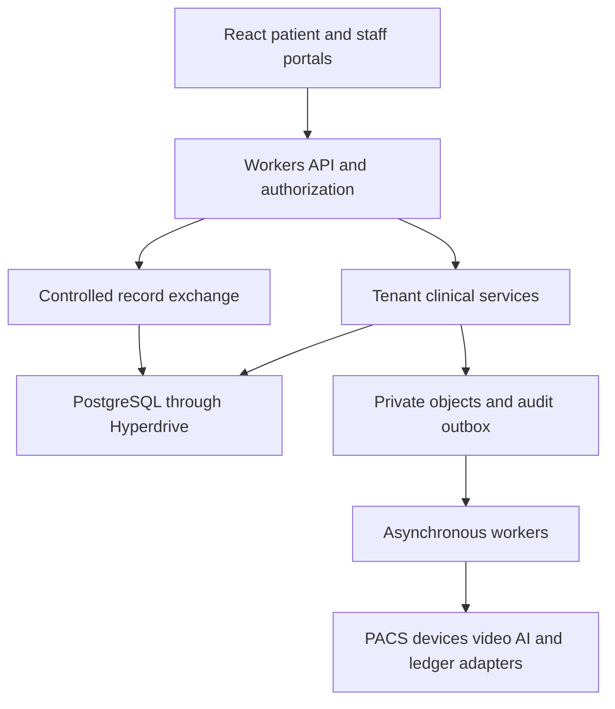

# Medveris implementation kit

Version 1.1 • 25 October 2026 • Prepared for Omuut Tom

This kit turns the supplied Medveris vision into a staged engineering specification. Use Medveris as the canonical product name; “Mediverse Cloud” is treated as a descriptive name pending an explicit branding decision. This is a build specification, not a completed application, clinical validation, security certification, or legal approval.

## Start here

1. Copy this directory into the actual application repository as `planning/medveris/`.
2. Read `MASTER_BUILD_PROMPT.md` and give its entire contents to OpenCode or your coding agent.
3. Start with milestone M0, then deliver M1 as an end-to-end outpatient foundation using synthetic data.
4. Use `docs/15_ACCEPTANCE_TESTS.md` to assess each milestone. Later modules remain explicitly unavailable until implemented and accepted.
5. Keep architecture decisions, implementation status, and test evidence in the repository. Replace assumptions with documented decisions as partners and infrastructure are selected.

## Contents

| File | Purpose |
|---|---|
| MASTER_BUILD_PROMPT.md | Copy-ready coding-agent instruction |
| docs/01_PRODUCT_REQUIREMENTS.md | Vision, scope, requirements, priorities |
| docs/02_ROLES_AND_ACCESS.md | Roles, authorization, consent and exchange |
| docs/03_ARCHITECTURE.md | Workers deployment, services, isolation and flows |
| docs/04_DATA_MODEL.md | Entities, relationships, invariants and migration plan |
| docs/05_API_CONTRACT.md | Endpoint inventory and behavior |
| docs/06_CLINICAL_WORKFLOWS.md | Departmental workflows and state transitions |
| docs/07_UX_SPECIFICATION.md | Screens, navigation and interaction requirements |
| docs/08_SECURITY_AND_THREAT_MODEL.md | Threats, controls and verification |
| docs/09_AUDIT_AND_LEDGER.md | Amendment history, audit and blockchain boundary |
| docs/10_PROVIDER_TRUST.md | Credential evidence, verification and capability claims |
| docs/11_AI_AND_RADIOLOGY.md | AI boundaries, validation and imaging architecture |
| docs/12_TELEMEDICINE_AND_IOT.md | Remote care, device ingestion and alerts |
| docs/13_INTEROPERABILITY.md | FHIR, terminology, DICOM and public health exchange |
| docs/14_DELIVERY_BACKLOG.md | Staged implementation and dependency order |
| docs/15_ACCEPTANCE_TESTS.md | Testable release criteria and traceability |
| docs/16_OPERATIONS_AND_DEPLOYMENT.md | Environments, CI, backups and incident response |
| docs/17_GOVERNANCE_AND_DECISIONS.md | Clinical safety, privacy review and open decisions |
| docs/18_SOURCES.md | Primary technical and healthcare references |
| docs/19_STANDARDS_IMPLEMENTATION.md | Required FHIR, DICOM, SNOMED CT, LOINC and UCUM implementation |
| docs/20_API_INTEGRATION_REGISTRY.md | Standard and operational APIs and external adapters |
| specs/integration-config.example.json | Non-secret integration configuration template |
| specs/standards-traceability.csv | Standards requirements and acceptance mapping |
| specs/openapi-standards.json | Starter standards endpoint discovery contract |
| specs/clinical-coding.schema.json | Versioned coding representation |
| specs/clinical-entry.schema.json | Example immutable clinical entry contract |
| specs/device-observation.schema.json | Example device ingestion contract |
| specs/openapi-foundation.json | Starter OpenAPI contract for an M1 subset |
| specs/hazards.csv | Initial clinical and privacy hazard register |
| specs/backlog.csv | Importable milestone backlog |

The machine-readable contracts are starting contracts for defined slices, not complete implementations of FHIR, DICOM, or all hospital workflows. Version 1.1 makes these standards required staged capabilities; actual conformance still requires implementation and validation. Markdown is authoritative for product intent; the implemented API and tests must evolve together with the contracts.

## Proposed defaults

React and TypeScript UI; TypeScript API on Cloudflare Workers; PostgreSQL clinical system of record through Hyperdrive with query caching disabled for protected data; private object storage; asynchronous queues; separate PACS, device gateway, video media, and model inference services. Preserve a working existing backend where migration would add risk. No real patient data in development, examples, or previews.

The documents contain proposed engineering targets and policy defaults. Named clinical, security and governance owners must approve applicable production decisions. No claim is made that all required local forms, country integrations, clinical protocols or jurisdiction-specific legal documents are included.

## Version 1.1 changes

FHIR R4, DICOM/DICOMweb, SNOMED CT and LOINC are now explicit staged implementation requirements throughout the prompt, architecture, data model, workflows, security, operations and tests. New documents 19 and 20 define service contracts and the operational API registry. Acceptance now includes 36 scenarios. Supporting examples remain design artifacts, not evidence of running services or clinical/standards certification.

---

# Medveris master build prompt

You are the implementation engineer working in the actual Medveris application repository. Build the system described by the accompanying `docs/` and `specs/` documents. Implement working software and verify it; do not stop at a plan or create only a visual prototype.

## Inspect before changing

Read AGENTS.md, repository documentation, this kit, package manifests, existing authentication, backend services, database migrations, tests and Cloudflare configuration. Inspect git status and preserve unrelated changes. Identify whether an existing Phoenix, Node or other backend is already functional. Keep and integrate working functionality; do not rewrite or migrate a clinical database merely to match the proposed default stack. Record any architecture deviation and its migration implications.

If the repository is empty, scaffold a TypeScript workspace with `apps/web`, `apps/api`, `apps/jobs`, `packages/domain`, `packages/authz`, `packages/db`, `packages/contracts`, `packages/ui`, `tests` and `docs`. Use React and TypeScript for the web application, a Workers-compatible HTTP framework such as Hono for the API, PostgreSQL for clinical transactions, and a Workers-compatible PostgreSQL driver validated against the selected Hyperdrive configuration. Pin compatible supported versions after checking current official documentation. Do not assume this kit pins a current package version.

## Product and scope

Medveris provides free patient and provider registration, tenant-isolated facility operations, a unique patient identifier, and authorized cross-facility longitudinal records. Provider licenses may be submitted optionally. Submitted evidence is not verified evidence, and verified credentials are not proof of clinical competence. Facilities without verified credentials may onboard, while regulated actions remain subject to the adopted jurisdiction and role policies.

Cover reception, outpatient care, emergency and recovery, wards, pediatrics, adult male/female wards, surgery, NICU, ICU, maternity, theatre and anesthesia, primary and community care, diagnostics, pharmacy, administration, finance, public health, chronic care, hospice and palliative care. Build in milestones. Do not pretend that later modules are implemented by displaying fabricated metrics or functioning-looking buttons.

## Non-negotiable invariants

1. A patient ID locates an identity and never authorizes record access. Return no patient information to an anonymous lookup.
2. Derive actor and tenant context from an authenticated, current membership; never trust a browser-supplied tenant ID alone. Enforce resource-level authorization on the server and tenant isolation in the database.
3. Cross-facility record access uses a dedicated exchange policy path with purpose, care relationship, permitted legal basis or consent, scope, expiry, sensitivity filtering and durable audit. An ordinary tenant connection cannot read another tenant's tables.
4. Require MFA for staff clinical access and privileged functions; protect recovery, session revocation, role changes, impersonation and exports. A facility administrator has no automatic clinical access.
5. Preserve original signed clinical entries. Changes append a version with a mandatory reason, author, timestamps, prior version, and current-version concurrency check. Draft edits also receive audit notes. Use entered-in-error states and governed corrections rather than destructive deletion.
6. Clinical writes, amendment metadata, audit events and transactional outbox records commit together. A signed entry cannot succeed without its audit record. Protected reads are durably audited before returning data; define a fail-closed response when that audit cannot be persisted.
7. Keep clinical data, patient IDs, images and identifiable metadata off public blockchains. Implement signed audit checkpoints and a LedgerAdapter interface. Production anchoring requires an explicit ledger and governance decision. Never label unanchored events as blockchain-confirmed.
8. Disable shared caching for authenticated responses, clinical queries and permission decisions. Use `Cache-Control: no-store` and verify Cloudflare, Hyperdrive, browser service workers, analytics and logs do not expose protected content.
9. AI output is a reviewable suggestion with evidence references and model provenance. Never silently write AI diagnoses, prescriptions or monitoring actions into signed records. Keep predictive and image interpretation features disabled until their intended-use validation is approved.
10. Devices cannot directly control treatment. Cloud observations cannot replace bedside critical alarms. Display data freshness and unreliable readings. Do not ship invented clinical thresholds.
11. Use synthetic patients only for seeds, previews, tests and demonstrations. Never invent provider verification, source records, clinical results, model performance or compliance claims.
12. Return genuine error and integration states. No mocked production email delivery, payments, PACS, blockchain, AI or device connectivity.

## Execute in order

### M0 Repository and architectural foundation

Produce a concise repository audit and gap matrix, then implement missing local configuration, dependency pinning, strict typing, environment validation, health checks, reproducible PostgreSQL development services, migration scripts and CI. Create a status file listing supported, incomplete and unavailable workflows. Use `.env.example` with placeholders only. Do not expose secrets in logs.

### M1 First working clinical slice

Implement real patient signup and staff/facility onboarding with provider adapters and a local mail sink. Add unique random patient IDs, patient identity confirmation, verified membership switching, MFA, session revocation, a patient portal, reception and queues, encounters, structured observations with units, allergies with unknown/none/known distinctions, clinician-authored signed notes, amendments with mandatory reasons, and role-filtered records. Add scoped consent, revocation, cross-facility exchange of permitted records, and time-limited break-glass access with reason, MFA reauthentication and review tasks. Add credential upload quarantine, manual verification workflow and expiry handling. Add durable audit and an outbox with idempotent processing. Implement permission-safe empty, denied, loading and integration-failure UI states.

M1 acceptance demonstration: synthetic patient registers once; facility A treats the patient and signs a note; facility B is denied until an authorized exchange grant exists; B then sees only permitted source-labelled entries; A amends its note with a reason and prior-version preservation; revoke the grant and B's next request and document fetch fail. Neither facility can edit the other's source record. A receptionist and finance user cannot retrieve clinical notes. Evidence includes real integration and browser tests, not only screenshots.

### M2 through M5

Follow `14_DELIVERY_BACKLOG.md` in order: departmental workflows; operations and public health; telemedicine and bounded device pilots; then validated clinical AI, task-specific radiology interpretation and approved ledger anchoring. Implement only the next explicitly selected milestone after passing the previous gate. In this initial run complete M0 and M1 as far as the actual environment supports; do not attempt every hospital module in one pass. Record blocked external setup precisely and continue all independent local work.

## Required engineering behavior

Use schema-validated inputs, parameterized SQL, database constraints, transactional domain operations, authorization middleware plus resource checks, least-privilege database roles and RLS tests under the real runtime role. Transaction-local request context must not leak across pooled connections. Do not use a broad privileged database role in the general API. The exchange service needs a separate narrow role and explicit projections; request context alone is not proof of authorization.

Add cursor pagination, idempotency for retryable commands, optimistic concurrency, safe file processing, queue deduplication, error correlation IDs, consent rechecking at execution/delivery, and redacted structured logs. Implement two tenants and a patient portal in the integration fixtures. Tests must run against PostgreSQL for PostgreSQL behavior. Contract tests must exercise the actual HTTP handlers.

Use no-store clinical responses and private authenticated object delivery. Do not put identifiers in public URLs, QR access tokens, analytics events or generic error messages. For real integrations, validate vendor security, regions, contractual restrictions and intended use before sending patient data. Develop behind disabled feature flags when accounts or approval are absent.

## Verification and completion report

Run formatter/linter, type checks, unit tests for domain transitions, PostgreSQL isolation and concurrency tests, API contract tests, required Playwright flows, production builds, and a Workers runtime smoke test using the repository's actual commands. Test logout, membership removal, revoked consent, direct object access, stale versions, duplicated queue delivery and audit persistence failure. Inspect browser UI at desktop and mobile sizes. Fix failures caused by your changes.

At completion report: changed files, implemented user journeys, commands and results, migration instructions, exact remaining integrations, feature flag states, known limitations, and the next milestone. Maintain requirement-to-test evidence. Do not describe an unexecuted check as passed. Do not mark this system clinically validated or production-ready because it compiles. Prepare deployment configuration and a reviewable release; deploy only within the user's actual authorization and never reset a production database.

## Required standards and integration implementation

Apply documents 19 and 20 as part of the core build, not as an optional future appendix. Implement HL7 FHIR R4 4.0.1 profiles and a restricted `/fhir/r4` facade, production-configurable SNOMED CT/LOINC terminology services, UCUM quantitative units and DICOM/DICOMweb imaging integration by the stated milestones. Read the standards acceptance scenarios AT27–AT36. Preserve prior invariants on consent, source ownership, signed-record amendments and audit across every standard endpoint.

In M0 choose the FHIR engine/facade, pin implementation-guide packages, define coded data types and terminology/PACS adapter contracts, and record content rights and supported versions. In M1 implement field-specific coded entry with reviewed SNOMED CT/LOINC value sets, lookup/expansion/code validation, release-aware storage, and a minimal FHIR resource projection with a truthful CapabilityStatement. Use synthetic fixtures and a clearly labelled test terminology adapter locally. Configure a genuine licensed production terminology service before standardized clinical use. Do not connect production entry to public training/demo services.

In M2 implement PACS QIDO-RS, WADO-RS and STOW-RS with patient/study reconciliation, private object/frame/metadata access, DICOM conformance checks, LOINC laboratory mappings, ImagingStudy and DiagnosticReport linkage. Hospital DIMSE/worklist adapters require actual device/site testing. Do not implement heavy terminology indexing or a PACS inside a lightweight Worker.

Use Coding/CodeableConcept semantics with system, version, code as string, display and original text; validate contextual bindings server-side. Never invent concept identifiers or treat fuzzy text matching as an approved code mapping. Preserve historical signed codes on terminology upgrades. Define local/text draft behavior during terminology outages without exporting unvalidated codes as standards-compliant.

Expose standard FHIR responses/media types, OperationOutcome, resource versioning and scoped paging/search; never reuse a native generic error wrapper at the FHIR boundary. Disable unimplemented transaction, bulk export and external update capabilities. Future writes must invoke domain commands and mandatory reasoned amendments. Apply source/tenant/consent checks to search, includes, history, images, frames, metadata and downloads. Update profile validation reports, mapping evidence, adapter contract tests and all machine-readable specifications before declaring a standards capability complete.

---

# Product requirements

Status: proposed baseline. Product owner: Omuut Tom. Clinical and privacy owners: to appoint before clinical deployment. Scope is a multi-tenant healthcare platform, not a single hospital installation. Free registration is required; subscription pricing, transaction fees and other monetization are undecided.

## Outcomes

Patients maintain one longitudinal identity across participating facilities. Each facility conducts its own operations without seeing another facility's confidential administrative information. Authorized care teams receive relevant shared clinical history with provenance. Every alteration remains attributable. Provider trust communicates evidence rather than promising outcomes. AI and devices assist approved workflows without assuming clinical responsibility.

## Requirements

| ID | Requirement | Initial stage | Acceptance reference |
|---|---|---|---|
| PR01 | Free patient registration, recovery and non-sequential unique primary ID | M1 | AT01 |
| PR02 | Free facility/practitioner onboarding and optional credentials | M1 | AT02 |
| PR03 | Tenant memberships, role scopes, MFA and session revocation | M1 | AT03 |
| PR04 | Longitudinal record with source facility and author | M1 | AT04 |
| PR05 | Consent-scoped exchange and reviewed emergency override | M1 | AT05 |
| PR06 | Append-only signed records, audit notes and provenance | M1 | AT06 |
| PR07 | Reception, queues, triage, outpatient encounters | M1 | AT07 |
| PR08 | Admissions, bed transfers, ward observations and discharge | M2 | AT08 |
| PR09 | Emergency, maternity, pediatric, NICU, ICU and theatre workflows | M2 | AT09 |
| PR10 | Laboratory, radiology, pharmacy and medication administration | M2 | AT10 |
| PR11 | Finance, insurance, procurement, inventory and administration | M3 | AT11 |
| PR12 | Primary care, chronic care, hospice and palliative care plans | M3 | AT12 |
| PR13 | Public health surveillance and authorized reporting | M3 | AT13 |
| PR14 | Video consultations and remote follow-up | M4 | AT14 |
| PR15 | Validated device observations and alert routing | M4 | AT15 |
| PR16 | Evidence-linked diagnostic assistance and prediction | M5 | AT16 |
| PR17 | Modality-specific radiology analysis and reviewed reporting | M5 | AT17 |
| PR18 | Verifiable audit integrity and separately governed ledger anchors | M1/M5 | AT18 |

## Nonfunctional targets

These are proposed planning targets, not vendor guarantees or clinical monitoring performance claims. At an initial declared test load of 50 active users across two tenants, target p95 ordinary chart metadata requests below 2 seconds and p95 write acknowledgement below 3 seconds, measured from the pilot region with a realistic database. Exclude image transfer, video and inference and report them separately. Target 99.9% monthly availability for core workflows after pilot, database RPO at most 15 minutes and RTO at most 4 hours, subject to budget and tested backup capability. Confirm the pilot's acceptable downtime before launch.

Support mobile and desktop browsers, keyboard operation, accessible contrast, clear focus and text labels. Target WCAG 2.2 AA and verify rather than claim certification. Localize dates, language, timezone and currency. Persist clinical instants in UTC, source timezone when relevant, and distinct clinical occurrence versus entry timestamps. Support uncertainty in demographics and unknown clinical states.

## Scope exclusions and acceptance boundaries

No autonomous diagnosis, prescribing, image clearance, life-support control, universal automatic license verification, national-ID dependence, or unrestricted global clinical record search. No single AI model is assumed to interpret all radiology modalities. Device and public health integrations are adapter-specific. Offline clinical writing is deferred pending conflict, identity and device-storage designs; provide downtime procedures instead. No payment plan may make emergency escalation depend on a billing result.

The first release is an outpatient foundation, not an accepted ICU or theatre system. Later departmental releases require workflow acceptance by the participating clinical teams.

## Required standards and API capabilities

PR19: Implement the HL7 FHIR R4 exchange baseline and validated resource profiles, beginning in M1 (AT27–AT28). PR20: Implement production-configurable SNOMED CT/LOINC terminology lookup, contextual selection and server validation with release-aware persistence in M1 (AT29–AT31). PR21: Implement PACS-backed DICOM/DICOMweb acquisition integration, discovery, storage and retrieval in M2 (AT32–AT33). PR22: Use LOINC/UCUM device observation mappings and reviewed terminology for analytics/AI (AT34–AT35). PR23: Maintain API ownership, configuration, vendor rights and resilience evidence across all operational adapters (AT36). Documents 19 and 20 define normative stage details. These strengthen the earlier candidate terminology wording: standards are required, while exact editions, licensed content and partners require documented selection.

---

# Roles and access policy

## Authorization rule

Permit an action only when authentication is valid, the session is current, the actor has an active membership and required privilege, resource scope matches, and clinical access has an approved care relationship, purpose and applicable legal basis. For cross-facility access also require an active exchange authorization, sensitivity filtering and a durable access audit. Deny by default. Consent is one possible legal basis; do not assume every treatment, emergency or public health activity uses consent. Jurisdiction policy determines exceptions.

| Actor | Permitted baseline | Excluded by default |
|---|---|---|
| Patient | Own identity, released records, appointments, consent, access history | Other patients, raw staff directories, unreleased results |
| Authorized guardian/proxy | Explicitly delegated patient scopes and valid dates | Automatic access to every dependent record |
| Receptionist | Minimal identity confirmation, registration, queues, appointments | Clinical narratives and sensitive diagnoses |
| Nurse/midwife | Assigned care observations, nursing records and authorized medication workflow | Unassigned patients and unrestricted prescribing |
| Clinician | Assigned encounters, clinical orders and signed notes within approved scope | Editing another facility's originals |
| Pharmacist | Valid medication orders, dispensing and relevant safety information | General access to unrelated clinical notes |
| Laboratory staff | Requests, specimen data and authorized results | General narrative histories |
| Radiology staff | Assigned imaging orders, relevant context and role-approved reports | Other patients' studies |
| Finance | Invoices, coverage, payments and minimum service coding | Full medical histories |
| Facility administrator | Staff, departments, facilities and policy administration | Clinical access by virtue of admin role alone |
| Credential verifier | Assigned verification evidence and decision history | Patient care records |
| Public health officer | Approved aggregate reports or scoped statutory disclosures | Routine unrestricted identifiable chart browsing |
| Auditor | Authorized audit metadata with protected-detail controls | Editing audit records |
| Platform operator | Infrastructure metrics and operational tools | Standing access to patient charts |
| Integration account | One adapter's scoped resources and tenant | Interactive staff privileges |

Users can hold multiple memberships, but each request has one explicit active context. Switching contexts re-evaluates permissions and clears client clinical state. Role changes and membership removal invalidate sessions or force current entitlement rechecks. Staff verification state and professional scope may restrict clinical actions independently from account creation.

## Patient identity and exchange

Issue an opaque cryptographically random public patient identifier, distinct from internal primary keys; optionally add a transcription checksum. The ID is not a password. QR codes contain only a locator and no reusable access secret. A patient can receive care without a phone or national ID through an assisted workflow. Record verification method and identity confidence; do not turn uncertain demographics into false certainty.

An authenticated staff lookup supplies exact ID plus identity confirmation through an approved process. Rate-limit and audit lookup. Show only minimum confirmation details allowed for that role and disclose clinical content only after authorization. Handle unconscious or unidentified patients with temporary identities and governed reconciliation. Never automatically merge likely duplicates. Require documented review and reversible linkage history, with dual review for merges.

An exchange grant records subject, recipient tenant, permitted resource categories, source scope, purpose, legal basis, policy version, authority/consent evidence, start, expiry, sensitivity restrictions and revocation. Patient delegation is separately versioned. Consent is not bundled into terms acceptance or used as blanket consent for research, marketing, AI training and all future care.

Revocation blocks subsequent requests and pending deliveries; recheck at query, asynchronous execution and object retrieval. Already lawfully received information cannot be technically recalled from a clinician's memory or arbitrary downloaded copies. Log disclosures and apply recipient retention obligations.

## Emergency override

Break-glass is a separate narrowly scoped authorization, not a global role. Require eligible staff, reauthentication, patient and encounter context, emergency reason and expiry. Proposed maximum is 60 minutes, configurable only through approved policy. Record use immediately, create a review task due within one working day, and notify the appropriate privacy/clinical team. Patient notification timing and restricted categories follow approved policy. Neither emergency access nor a grant allows amendment of another tenant's record.

## Decision evidence

Audit actor, active role, purpose, target reference, decision, reason code, policy version and grant/override reference. Sanitize denial messages to prevent identifier enumeration. Separate patient-readable access history from security-investigation details. Test permissions on lists, counts, filters, exports, notifications, search, file URLs and background jobs, not just detail pages.

## Standard endpoint authorization

FHIR scopes, patient references and DICOM study UIDs do not confer access independently. Apply the same permissions to FHIR read/search/history, included resources, terminology entitlements and DICOMweb metadata/frames/bulk data as to native screens. Distinguish a terminology-content entitlement from permission to read a patient's chart. Integration clients receive explicit resource/action/tenant scopes and current grant checks. Keep audit and consent resources more restrictive than ordinary clinical data. AT28 and AT33 test these boundaries.

---

# System architecture

## Proposed topology

React and TypeScript serve the UI. Cloudflare Workers host API orchestration and lightweight background handlers. PostgreSQL provides transactional records, relational integrity and RLS. Hyperdrive supplies database connectivity; disable its query cache for authorization-dependent and clinical queries. Private object storage holds protected documents under an authenticated delivery path; a PACS manages DICOM studies and imaging lifecycle. Use queues for scan jobs, notifications, exports and audit anchors with transactional outbox delivery. Durable Objects may coordinate bounded real-time sessions where justified; they are not the clinical system of record.

Heavy image processing, model inference, long-running analysis, MQTT/device gateways, video media servers and hospital-local modality interfaces run in dedicated services. Workers receive signed, scoped adapter requests and results. Do not assume Workers can host all infrastructure or that every selected Cloudflare service has the same regional processing guarantees.

## Boundaries

Separate platform identity, tenant operations and authorized record exchange. The global patient directory contains minimal identity and controlled record pointers. Clinical entries retain source tenant ownership. Tenant administrative records, prices, staff notes and business reports never become part of the shared chart automatically. Internal global UUIDs do not confer access.

The tenant API uses a runtime role with no superuser, ownership or BYPASSRLS privileges. RLS policies validate tenant ownership and prevent cross-tenant inserts. Use composite keys/FKs where a child must share its parent's tenant. Bind trusted context transaction-locally and clear it by transaction completion; missing context denies. Verify behavior using the actual pooling driver. Do not treat arbitrary client-set PostgreSQL configuration values as trusted access credentials.

The exchange service uses a separate role allowed only narrow read projections and grant checks, not an unrestricted application-admin connection. A reviewed database function or service-mediated query returns approved categories and source attribution only after grant validation. Pin function search paths, parameterize input and minimize privileges. Enforce revocation against the primary database. Do not circumvent tenant isolation by turning off RLS in ordinary requests.

## Transactions and failure

Clinical commands execute validation, current-policy checks, expected-version checks, domain writes, audit events and outbox insertion in one transaction. Outbox dispatcher retries with stable event IDs. Consumers deduplicate transactionally; assume at-least-once delivery. The clinical commit does not wait for email, blockchain confirmation or AI.

For protected reads, select authorized content and persist access evidence before returning bytes. If policy validation or audit persistence fails, return a recoverable service error without chart data. Maintain hospital downtime procedures rather than silently bypassing controls. Recheck grants on downloads; do not distribute durable bearer links as the normal cross-facility mechanism.

## Configuration and module layout

Recommended modules: identity; organizations; credentials; patients; access-policy; encounters; clinical-records; orders; inpatient; theatre; pharmacy; diagnostics; billing; public-health; telehealth; devices; AI; audit. Start as a modular application with clear interfaces; split services only at actual trust, runtime or scaling boundaries.

Environment configuration declares database and storage regions, issuer/audience, secrets references, allowed origins, provider adapters, audit signing key ID, retention policy version and feature flags. Validate at startup. Keep development, staging and production databases, buckets, keys, origins and integration accounts separate. A development mail sink and synthetic adapter are development-only.

## Architecture decisions

ADR01: prefer PostgreSQL for the proposed new clinical backend; retain a working existing backend unless a reviewed migration warrants replacement. ADR02: use FHIR R4 mappings at exchange boundaries, not arbitrary JSON advertised as full FHIR. ADR03: retain private clinical storage and externally verifiable audit proofs rather than on-chain patient records. ADR04: disable clinical query caching. ADR05: separate real-time cloud assistance from certified bedside monitoring. Revisit these with actual provider contracts, load tests and regional constraints.

## Required standards service boundaries

Add a FHIR facade or maintained engine integration, a terminology adapter to a suitable dedicated production terminology service, and a PACS/DICOMweb adapter. Workers authorize and orchestrate these services; PostgreSQL remains the source-owned transactional model unless a reviewed alternative is selected. FHIR projections are derived from versioned domain state. SNOMED CT and LOINC content indexes run in suitable external infrastructure; PACS manages original DICOM objects. Document 19 supersedes candidate-only terminology selection with required staged support. Record ADR06 for FHIR profile/version strategy, ADR07 for terminology service and rights, and ADR08 for PACS conformance and modality gateway design.

---

# Data model and invariants

This is a logical model for migration design. It is not a ready-to-run database migration. Generate versioned SQL from the actual repository and verify constraints under the runtime database roles.

| Domain | Principal entities | Required relationships or fields |
|---|---|---|
| Identity | users, sessions, authenticators, recovery_events | Issuer subject unique; session expiry, revocation and MFA state |
| Tenancy | tenants, facilities, departments, memberships, role_assignments | Membership links actor to tenant; facility and department hierarchy |
| Patient identity | patients, patient_identifiers, identity_evidence, proxy_grants, merge_events | Global internal patient key; unique public locator; provenance and confidence |
| Facility registration | tenant_patient_links | Unique tenant/patient pair; local MRN unique within tenant |
| Access | care_relationships, consent_versions, exchange_grants, emergency_overrides | Resource scope, purpose, basis, version, authority, dates and revocation |
| Trust | credential_submissions, credential_versions, verification_checks, capability_claims | Subject facility/practitioner, issuer, evidence, status, expiry and reviewer |
| Front desk | appointments, queue_entries, encounters | Patient, tenant, location, encounter type, state and clinical times |
| Record | clinical_entries, clinical_entry_versions, record_attestations | Immutable signed content; prior version, reason, author, source and signature |
| Clinical facts | conditions, allergies, observations, care_plans, procedures | Encounter/patient/tenant references, coding, clinical status, provenance |
| Medication | medication_orders, dispense_events, administration_events | Prescriber, dose/units, route, timing, status and override evidence |
| Diagnostics | service_orders, specimens, lab_results, imaging_studies, diagnostic_reports | Order lineage, specimen identity, study UIDs, preliminary/final amendments |
| Inpatient | admissions, bed_assignments, transfers, nursing_tasks | Patient occupancy intervals; ward capability and assignment history |
| Theatre | theatre_cases, checklists, anesthesia_records, recovery_events | Consent, team, laterality/site, timestamps, procedure and handoff |
| Chronic/hospice | programme_enrolments, goals, followups, advance_care_documents | Patient goals, symptom measures, consent and versioned plans |
| Operations | invoices, invoice_items, payment_events, claims, stock_lots, stock_movements | Currency, decimal monetary values, lot/expiry, reversals and reconciliations |
| Telehealth | consultation_sessions, participants, communication_events | Appointment, consent, provider session reference and retention |
| Devices | devices, device_assignments, device_observations, alert_rules, alerts, acknowledgements | Tenant, patient binding interval, units, sequence, clock quality and escalation |
| AI | ai_jobs, model_versions, evidence_refs, ai_outputs, clinician_reviews | Intended use, model/prompt versions, input snapshot digest and approved disposition |
| Exchange | source_record_pointers, disclosure_events, export_jobs, import_jobs | Approved source projections, recipient, grant and delivered artifact digest |
| Integrity | audit_events, outbox_events, integrity_batches, ledger_anchors | Actor/resource metadata, stable event IDs, checkpoints, proofs and delivery state |

## Common field conventions

Use immutable UUID internal keys generated by a cryptographically secure source. Tenant-owned rows include `tenant_id`, and clinical rows include `patient_id`, `source_tenant_id` where distinct, occurrence time, recording time and author identity. Store timestamps with timezone-aware semantics. Store measured values with a code system and unit; do not discard original device units when normalizing. Use decimal/NUMERIC for money, explicit currency, and integer precision rules per currency. Store unknown, absent and explicitly negative observations separately.

Clinical narrative content may be structured JSON with a schema version alongside typed searchable projections. Do not use a JSON blob as an excuse to omit referential integrity. Code fields include system URI, code, display, version and optional original text. Uploaded objects include opaque object key, checksum, detected MIME, size, scan state, uploader, retention class and access scope.

## Clinical entry version contract

`clinical_entries` owns stable entry ID, patient, tenant and current-version pointer. `clinical_entry_versions` owns version ID, version number, previous version ID, content schema/version, exact canonical-content digest, author, occurrence/recording/signing times, status and mandatory change note. First versions describe the creation reason; later versions reference the original and explain correction. Signing and amendments are explicit commands. Never update signed content in place.

Lock the stable entry while appending or use an equivalent compare-and-swap on current version. Enforce unique `(entry_id, version_number)` and reject stale writes with 409. Version-specific attestations reference the exact content digest. Administrative projections may update with audit; historical signed bytes remain preserved subject to governed retention rules.

## Critical constraints

1. Unique global public patient ID; no national ID or telephone as the primary key.
2. Composite tenant references prevent tenant A's encounter linking to tenant B's internal order.
3. Bed occupancy intervals cannot overlap for one active bed; patient admission constraints prevent unintended duplicate active admissions.
4. Each dispensing, payment, ingestion and command retry carries a unique scoped idempotency key.
5. No signed version or audit event UPDATE/DELETE by runtime roles. Restrict maintenance roles and independently monitor them.
6. Foreign keys for provenance references and precise state transitions. A report cannot be finalized without an authorized signer.
7. Consent expiry and revocation checked at access time, not only scheduled cleanup time.
8. Device observations reference the assignment valid at measured time; ambiguous delayed assignments require reconciliation.

## Indexes and migrations

Index tenant/patient/clinical-time queries, current memberships, active grants, encounter queues, bed occupancy, credential expiry, device/time sequences, audit resource/time and undelivered outbox events. Validate plans with realistic synthetic sizes. Protect query counts from cross-tenant leakage.

Use additive expand/backfill/verify/contract migrations. Maintain separate migration and runtime credentials. Test clean installation and upgrade from the previous release; take and restore-test backups before destructive changes. Do not reset databases to resolve migration failures. Backfills record provenance and any known missing history.

## Standards data model extensions

Add `terminology_releases`, `value_set_versions`, `concept_map_versions`, `coding_validations`, `local_code_mappings`, `integration_clients`, `fhir_profile_versions`, `fhir_resource_links`, `external_identifier_links`, `dicom_study_links`, `dicom_instance_metadata` and `integration_reconciliation_events`. Map resource type/logical ID/version to native source/version without conflating them. Patient.identifier includes identifier system/issuer; do not equate a facility DICOM PatientID with the global Medveris identity.

Coded concepts persist system URI, edition/release version, string code, display at entry, original text, user selection and validation/value-set context. LOINC-coded measurements retain specimen/method where relevant, UCUM unit code and raw device unit. Imaging links retain Study/Series/SOP Instance UIDs, accession, SOP class, transfer syntax and source archive. Code maps preserve relation/equivalence, reviewer and versions. See `specs/clinical-coding.schema.json`; the generic entry content still needs a domain schema incorporating these types.

---

# API contract

Version prefix `/api/v1`. This endpoint inventory is the target contract; `specs/openapi-foundation.json` covers a selected M1 subset. The coding agent must expand the machine-readable specification with implementation, not report every endpoint here as available.

## Common behavior

Authenticate browser requests with secure HttpOnly cookies and CSRF protection on state-changing requests, or an approved OIDC token architecture with documented storage and audience validation. Do not improvise a new password/MFA system. An active tenant header or path is a requested context checked against current membership, never independent authority. Patient portal requests use the verified patient-subject link. Integration tokens use a separate issuer/audience/scope profile.

JSON payloads use schema validation, bounded strings, strict identifier types and rejection of mass-assigned protected fields. Return generic errors as `{error:{code,message,correlationId,details?}}` without patient data, SQL or secrets. Use 401 unauthenticated, 403 unauthorized, 404 non-disclosing not-found where appropriate, 409 stale version/state conflict, 422 invalid domain values, 429 rate-limited and 503 required dependency unavailable. Do not turn a database failure into a false successful empty response.

All protected responses use no-store. Require `Idempotency-Key` for retryable creates and state-changing commands; bind to actor, tenant, route and request digest. Same key/different payload returns 409. Persist in the command transaction; proposed expiry is 24 hours, adjusted for longer external workflows. Versioned changes carry `expectedVersion` or an equivalent If-Match contract. Lists use opaque scoped cursor pagination and bounded page sizes; no unbounded chart exports.

| Area | Method and route | Behavior |
|---|---|---|
| Health | GET `/health/live`, `/health/ready` | Public liveness minimal; internal readiness details protected |
| Auth | Provider callbacks; POST `/auth/logout` | Use selected identity-provider flow and revoke current session |
| Sessions | GET `/me`; DELETE `/me/sessions/{id}` | Current context and session controls |
| Onboarding | POST `/tenants`; POST `/patients` | Register facility or patient without verified-credential claims |
| Membership | GET/POST `/tenants/{tenantId}/memberships` | Administrative scope and MFA required for assignment changes |
| Locator | POST `/patients/resolve` | Exact ID plus approved identity confirmation, rate-limited and audited |
| Patient portal | GET `/me/patient`; GET `/me/records` | Released records and verified subject linkage only |
| Consent | POST `/patients/{patientId}/consents` | Create versioned, scoped authorization evidence |
| Revocation | POST `/consents/{consentId}/revoke` | Revoke grants and pending deliveries in scope |
| Exchange | GET `/exchange/patients/{patientId}/records` | Grant-filtered projection with provenance |
| Override | POST `/patients/{patientId}/emergency-overrides` | Reason, encounter, reauthentication and expiry |
| Appointments | GET/POST `/appointments` | Tenant and role-filtered scheduling |
| Queue | GET/POST `/queues/{queueId}/entries` | Audited queue changes and limited clinical display |
| Encounters | POST `/encounters`; POST `/encounters/{id}/transitions` | Validated encounter transitions |
| Notes | POST `/encounters/{encounterId}/entries` | Draft with author and creation note |
| Signing | POST `/entries/{entryId}/sign` | Attest exact expected version |
| Amendments | POST `/entries/{entryId}/amendments` | New version with reason and concurrency enforcement |
| Observations | POST `/encounters/{id}/observations` | Typed measurement, units, source and clinical time |
| Orders | POST `/orders`; POST `/orders/{id}/transitions` | Scoped diagnostics/medication/service order transitions |
| Diagnostics | POST `/orders/{id}/results`; POST `/reports/{id}/sign` | Preliminary/final/corrected lineage and authorized sign-off |
| Admissions | POST `/admissions`; POST `/admissions/{id}/transfers` | Atomic patient and bed assignment |
| Theatre | POST `/theatre/cases`; POST `/theatre/cases/{id}/checklists` | Procedure-linked consent and safety checkpoints |
| Pharmacy | POST `/dispenses`; POST `/administrations` | Link order and patient; role and reconciliation checks |
| Credentials | POST `/credentials`; POST `/credentials/{id}/checks` | Quarantined upload references and verifier decisions |
| Files | POST `/uploads`; POST `/uploads/{id}/complete`; GET `/documents/{id}/content` | Private staged uploads, scan gate and policy-checked download |
| Finance | POST `/invoices`; POST `/payments`; POST `/payments/{id}/reversals` | Decimal amounts, idempotency and reconciliation |
| Public health | POST `/public-health/reports` | Approved dataset and purpose, aggregate-first |
| Telehealth | POST `/consultations/{id}/join-token` | Short-lived participant-scoped token after eligibility check |
| Devices | POST `/integrations/devices/observations` | Signed adapter ingestion and device assignment validation |
| Alerts | POST `/alerts/{id}/acknowledgements` | Actor acknowledgement and escalation state, no therapy command |
| AI | POST `/ai/jobs`; GET `/ai/jobs/{id}` | Async evidence-scoped job with task-specific eligibility |
| Review | POST `/ai/jobs/{id}/reviews` | Accept/reject/edit decision; explicit separate chart commit |
| Audit | GET `/patients/{id}/access-history` | Patient-appropriate disclosure view |
| Export | POST `/exports`; GET `/exports/{id}` | Authorized job, recheck before delivery and short expiry |

## Event envelopes

Internal events include `eventId`, `schemaVersion`, `eventType`, `tenantId`, restricted `patientRef` where necessary, `aggregateId`, `aggregateVersion`, `occurredAt` and `correlationId`. Keep PHI out of queue payloads when a scoped opaque pointer suffices. Consumers retrieve authorized content at execution time. Authenticate webhooks, verify timestamp/signature, reject replay outside a defined window and record delivery IDs. Notifications use generic text and route recipients to an authenticated portal.

## Contract examples

An amendment command contains `expectedVersion: 3`, a meaningful `changeNote`, the corrected content, and the clinical occurrence time if corrected. Server derives author, source tenant, recorded time, version and audit metadata. A read request cannot override any of those fields. Example JSON schemas are illustrative contracts and require domain-specific clinical fields before production use.

## Standard and adapter API families

Keep `/api/v1` for native operations, `/fhir/r4` for selected FHIR resource interactions, `/terminology/fhir/r4` for supported terminology operations, and an authorized `/dicomweb` gateway or approved private PACS base for imaging. Exact standard semantics belong to documents 19 and 20 and current pinned specifications. Native idempotency/error conventions do not automatically replace FHIR or DICOM conventions.

Require `/fhir/r4/metadata`; restricted resource read/search; tested version/history where enabled; CodeSystem lookup/code validation; ValueSet expansion/member validation; reviewed ConceptMap translation; and M2 QIDO/WADO/STOW. Standard writes must never bypass signed-record amendment notes or audit. `specs/openapi-standards.json` is a starter discovery/terminology path contract, not a full replacement for FHIR profiles or a DICOM conformance statement.

---

# Clinical and operational workflows

Each workflow requires local clinical owner review, role permissions, audit coverage, exception handling and user acceptance before release. Protocols, drug dosing, escalation thresholds and treatment pathways must come from approved clinical governance, not generated placeholder rules.

## Reception and outpatient care

Register or resolve patient → confirm identity → create appointment/walk-in encounter → queue → triage → clinician consultation → requests/prescription/referral → results review → discharge or admission → follow-up. Use a persistent patient banner with two appropriate identifiers and clearly distinguish temporary identities. Triage captures complaint, observations, allergies state, urgency and author. Make missing results and pending tasks visible before encounter closure.

Encounter states: planned → arrived → triaged → in-progress → completed; cancellation and entered-in-error require reasons. Reopening creates an explicit event. Queue transfers preserve history. Clinical notes: draft → signed → amended or entered-in-error; a correction never erases the original.

## Emergency and recovery

Allow temporary identity registration and immediate encounter creation without making administrative completion a prerequisite for resuscitation documentation. Capture triage, emergency team actions, serial observations, orders, critical results and handoffs. Record late documentation as such with separate clinical and recording times. Escalation follows the facility's actual emergency policy. Emergency access is distinct from ordinary registration and remains audited. Recovery includes post-procedure observations, handoff, discharge criteria and responsible clinician acceptance.

## Inpatient wards

Admission → capability-appropriate bed → nursing assessment → multidisciplinary care and medication administration → transfers → discharge/death/transfer-out documentation. Configure general, pediatric, adult male, adult female, surgical, maternity, NICU and ICU wards without hard-coding demographic restrictions that prevent documented clinical exceptions. Record bed-cleaning and unavailable states. Transfer assignment and release are atomic. Preserve isolation precautions and handoff tasks under appropriate access policies.

## Pediatric neonatal maternity and critical care

Pediatrics and NICU require birth date/time certainty, age-appropriate fields, weight with units and measurement time, guardian relationships and approved medicine validation. Link a newborn to maternal records through an explicit relationship while preserving separate patient identities and access rights. Maternity supports antenatal, labour, delivery, postnatal and referral records. Critical care supports high-frequency observation review, fluid balance, ventilation documentation and handoff. Do not label these modules as validated critical monitoring until device, alarm and workflow acceptance is complete.

## Theatre and anesthesia

Request procedure → preoperative assessment → procedure-specific consent → schedule and team allocation → identity/site/laterality confirmation → checklist stages → anesthesia and intraoperative record → counts/specimens/implants documentation → recovery handoff → postoperative plan. Capture exceptions with authorized sign-off. An ordinary booking cannot bypass consent and safety-check state. Emergency exceptions require the approved local protocol and reason.

## Laboratory and radiology

Order → collection/booking → specimen or study identity check → accession → processing/acquisition → preliminary result → authorized final report → acknowledgement and follow-up. Rejected specimens retain reason and recollection lineage. Corrected reports notify responsible teams and preserve prior versions. Critical-result communication records recipient, time, acknowledgement and escalation. Imaging worklists link patient, encounter, accession and DICOM study identifiers; ambiguous matching goes to reconciliation.

## Medicines and pharmacy

Order → clinical verification → dispensing → administration → reconciliation. Record ingredient/product, dose and units, route, frequency, duration, prescriber and current status. Distinguish unknown allergies from no known allergies. Prevent duplicate retries and document overrides. Safety checks use a governed drug database and validated rules; do not ship fabricated interaction or pediatric dose calculations. Stock changes occur through ledger events with lot, expiry, location and author. Controlled medicine handling follows applicable local policy.

## Primary chronic hospice and palliative care

Support immunizations, screening, community referrals and preventive follow-up. Chronic programmes include diabetes, hypertension and configurable conditions with longitudinal goals, appointments, observations, adherence and referrals. Hospice and palliative care include patient goals, symptom tracking, family contacts, advance-care documentation where applicable and coordinated home visits. Record patient preferences and clinician review; avoid predicting terminal outcomes from an unvalidated model.

## Finance administration and supplies

Price service → invoice → coverage/claim → payment reconciliation → reversal/refund. Maintain decimal precision and audit price changes. Billing access uses minimum necessary service data. Staff scheduling, procurement, stock requests, equipment maintenance and departmental configuration have distinct administrative roles. Do not store raw payment card data. Use hosted payment processing where selected and verify callback signatures.

## Public health

Define reporting programme and authority → validate source cohort → generate approved aggregate dataset → suppress or review small cells → authorize release → transmit → receive acknowledgement → reconcile corrections. Identifiable statutory reporting uses a separate restricted disclosure route with documented basis. Include provenance, case definition/version, date range, denominator, missingness and reporting facility. Government connectivity is not assumed to exist until an adapter is configured and tested.

## Coded workflow requirements

Complaint, findings, diagnoses and procedures use reviewed contextual SNOMED CT selections where licensed and appropriate. Lab/vital/device observation identities use validated LOINC mappings with UCUM quantitative units. Categorical answers use the chosen value-set binding rather than forced numeric conversion. Staff can inspect preferred term, code, system and version; uncertain/unmapped input remains visibly local until reconciled.

Radiology orders progress through reconciled accession and DICOM study identities, PACS acquisition, authorized DICOMweb viewing and DiagnosticReport/ImagingStudy exchange. Laboratory local tests require reviewed LOINC mapping before standardized publication. A corrected code or imported result creates an attributable version and follows notification workflows. Claims, surveillance and operational APIs use explicit reviewed translations, never assumed semantic equivalence.

---

# User experience specification

## Product structure

Use a public information area, patient portal, facility workspace and restricted platform operations console. Public visitors can read service information and begin free signup. Public pages expose only provider-approved directory details and verification facts, never patient search results. Choose one canonical Medveris brand before launch; do not reuse another product's logo.

## Screen inventory

| Workspace | Screens |
|---|---|
| Public | Home, patient signup, provider signup, directory, credential explanation, privacy and support |
| Patient | Home, patient ID card, records, appointments, medications, consent, access history, proxies, telehealth, account recovery |
| Reception | Registration, identity confirmation, daily schedule, queues, encounters and permitted billing summary |
| Clinical | Assigned worklist, chart, encounter editor, observations, orders, results, prescriptions, referrals and handoffs |
| Wards | Bed board, admissions, transfer dialog, nursing tasks, medication administration and discharge |
| Diagnostics | Order worklist, specimen accession, imaging viewer, preliminary/final report and critical result tracking |
| Theatre | Case board, preoperative assessment, checklist, anesthesia record and recovery handoff |
| Finance | Invoices, claims, payments, reversals, reconciliation and reports |
| Administration | Facilities, departments, memberships, credentials, policies, supplies and integrations |
| Governance | Verification queue, emergency access reviews, audit search, safety events and approved exports |

## Patient chart

Keep patient identity, active encounter, source facility and allergy state visible. Provide summary, timeline, conditions, medicines, observations, investigations, procedures, care plans and documents tabs. Show author/source, clinical time, entered time and signed/amended state. Distinguish preliminary from final reports, patient-reported from clinician-observed information, and AI suggestions from signed clinical facts. Restricted information must not leak through tab counts or hidden DOM content.

An amendment dialog requires reason and expected version, displays the previous value and proposed change, and confirms authorship. A conflict prompts reload and comparison; never silently overwrite. An exchange-access dialog describes what is requested, by whom, for which purpose and duration. A denied record offers permitted next actions without revealing protected details.

## Trust and AI presentation

Credential cards say Submitted, Verification pending, Verified, Expired, Rejected or Revoked and include dates and scope. Use text with icons, not color alone. A verified facility license must not imply every practitioner or listed service is verified. Capability claims show evidence and limitations.

AI panels show task, evidence links, missing information, uncertainty explanation, generation time, model/version and review controls. Label confidence only when a calibrated task-specific value is available. Do not display invented percentages. Absent or failed AI leaves manual clinical workflows usable. An image-analysis overlay remains traceable to its exact study/series/model and cannot masquerade as a final radiologist report.

## Interaction requirements

Target readable 16px body text, strong contrast, keyboard navigation, labeled inputs, semantic tables, appropriate touch targets and visible focus. Test mobile registration, patient portal and lightweight observations separately from workstation imaging. Support high zoom, narrow screens and low bandwidth. Do not assume reliable video or large-image access.

Every action has loading, empty, validation, denied, stale-data, conflict and dependency-failure states. Distinguish saved draft, saving, signed and unsaved work. Require confirmation for identity merges and irreversible privileged actions. Disable repeat submissions while preserving retry safety. Clear chart state on logout, tenant switch and patient switch. Warn before losing an unsaved clinical draft.

Persist no chart data in browser localStorage or generic service-worker caches. Idle lock and session expiry require safe draft handling within the approved storage policy. Use generic notifications without diagnosis details. Timestamp observations with freshness and connection state; stale data never looks live. Provide a documented downtime route when a required dependency is unavailable.

## Terminology and interoperability interfaces

Provide contextual clinical term search with preferred terms, synonyms, system, edition and active status. Persist the selected code behind the readable label. Do not expose a generic global code picker for every clinical field. For lab order catalogues show specimen/method details needed to select the correct LOINC mapping. A terminology outage or inactive concept has a clear local-draft/reconciliation state.

Provide restricted integration status, unresolved identity/mapping queues and import validation reports. The imaging viewer shows reconciled patient/study/accession identity, source archive and diagnostic-versus-preview limitations. FHIR export previews show included scope and source provenance without implying unrestricted access. Avoid dumping standard payload syntax into ordinary clinical tasks.

---

# Security and threat model

## Protected assets and trust boundaries

Assets include clinical content, identity directory, consent, staff credentials, audit proofs, device telemetry, payment references and encryption keys. Boundaries include public browser to API, API to database, tenant API to exchange, API to objects, hospital devices to gateway, gateway to cloud and cloud to external vendors. Assume malicious tenants, stolen staff sessions, compromised integrations, curious operators and accidental disclosure.

| Threat | Required control | Verification |
|---|---|---|
| Guessed ID or object reference | Non-sequential IDs, exact lookup controls and per-resource authorization | Anonymous and wrong-tenant requests disclose nothing |
| Tenant leakage | Runtime RLS, composite constraints, scoped repositories and narrow exchange role | Test all operations under actual runtime roles |
| Stolen staff session | MFA, secure cookies, expiry, recovery controls and revocation | Removed membership and revoked sessions fail immediately |
| CSRF or XSS | CSRF defense, strict origins, CSP, output escaping and safe rich text | Browser security tests; no unsafe rendered HTML |
| SQL injection | Parameterized queries and bounded filters | Fuzz inputs and inspect query construction |
| Malicious uploaded file | Size/type checks, quarantine, malware scan and private delivery | Mismatched MIME, malware and oversized files rejected |
| Audit tampering | Append-only runtime privileges, signed checkpoints, independent copies | Alteration and missing-event verification tests |
| Consent bypass | Central decision service and execution-time rechecks | Revoke during queued export and before download |
| Cache leakage | No-store, disabled protected query cache and client cache clearing | Two users and tenants never share responses |
| Device spoofing/replay | Device credentials, signatures, sequence tracking and assignment validation | Replay, wrong-patient and revoked-device tests |
| Model prompt injection | Treat records as untrusted evidence; no tool authority from documents | Malicious document cannot request data or invoke actions |
| Vendor data exposure | Approved contracts, retention, region and scoped payloads | Outbound integration inventory and egress tests |
| Insider misuse | Least privilege, no standing operator chart access, audited temporary access | Privileged access review and denied admin chart test |
| Ransomware or deletion | Isolated backups, protected retention and restore drills | Timed recovery from separate credentials |
| Export exfiltration | Minimal scope, reauthentication, size limits, expiry and audit | Revocation and object access tests |

## Identity and application controls

Use a maintained identity solution supporting staff MFA and secure recovery. Enforce TLS, credential rotation, secret stores, service token audiences and strict CORS. Rate-limit authentication, patient lookup and exports. Mask identifiers in logs. Disable session recording and third-party analytics on clinical pages unless explicitly approved and proven to exclude protected content. Do not attach patient names to error traces, URLs or email subjects.

Database access should be private where feasible, TLS-protected and restricted to approved origins/services. Use separate migration, tenant-runtime, exchange, audit-ingest and backup roles. FORCE RLS where appropriate; remember superuser and BYPASSRLS are exceptions. Review privileged functions and search paths. Test pooled context isolation and SQL behavior rather than assuming ORM scoping is enough.

## File and image lifecycle

Uploads move pending → quarantined → scanned → available/rejected. Verify declared versus detected type, file signatures, size and decompression limits. Strip unnecessary metadata for derivatives while retaining required original clinical evidence under policy. Reject active executable content. Protect DICOM metadata as patient data. Object keys are opaque and private. Scan completion and authorization must be checked before serving; possession of a URL is insufficient authority.

## Privacy engineering

Map collection purposes, access roles, processing locations, retention and sub-processors. Separate legal identity evidence from the ordinary chart. Limit public directory data. Distinguish operational processing from research and model training; disable training reuse by default. De-identification requires assessment of residual reidentification risk, including small cohorts, dates and images. Retain only the minimum data needed for each purpose and execute governed disposal across indexes, derivatives and vendors.

## Security acceptance

Before pilot: dependency and secret scans, permissions review, isolation tests, upload tests, external vendor review and recovery drill. Before broader clinical deployment: independent penetration testing and closure of high-impact findings, plus review of tenant exchange, identity merging, overrides, export and operator access. Security sign-off records the tested release and scope; it is not a blanket compliance certificate.

## Standards and integration threats

FHIR searches, `_include`, `_revinclude`, history, counts, pagination links and exports require the same record-level filtering as direct reads. Reject unbounded unsupported search and validate client scopes. Guard DICOMweb query/retrieve metadata, frames and bulk-data references against indirect object access. Disable arbitrary PACS or terminology URL proxying and validate destinations to prevent SSRF. ECL/filter/expansion requests have depth, length, pagination and execution limits. Keep code-system content rights and credentials behind server-side adapters; never place vendor credentials in React bundles. Log no patient-containing search terms to public terminology services.

---

# Audit amendments and ledger integrity

## Meaning of immutability

Medveris preserves the history of signed clinical records through append-only versions and independently verifiable evidence. This offers tamper evidence within a declared trust model; it cannot prove that an original clinical statement was true, prevent every administrator attack, or repair a wrong-patient entry automatically. Do not market a database hash alone as blockchain protection.

Clinical content, identity documents and radiology images remain in protected storage. Do not place patient IDs, names, record URLs, diagnosis codes or raw predictable-content hashes on a public ledger. Even hashes can create linkage and guessing risks. Anchor only reviewed batch commitments with randomized leaves and an explicit privacy assessment.

## Event and correction policy

Every create, draft edit, sign, amendment, status correction and entered-in-error action records a meaningful audit note. Also audit protected reads, lookup, denied access, disclosures, exports, consent, membership changes, credential decisions and emergency overrides. Automatically generated descriptions can cover routine draft saves; signed-record corrections require an explicit author-provided reason.

Clinical entry versions preserve original bytes or deterministic canonical representations, schema version, source, author, occurrence time, recorded time, signature and previous-version reference. Derived summaries may be refreshed, but retain their source-version references. An amendment records changed fields and a concise reason. Restrict sensitive details in access audit metadata; the audit system is itself protected data.

## Integrity pipeline

1. A clinical transaction inserts the version, its audit event and outbox event atomically.
2. The integrity worker reads immutable event IDs in deterministic partition order. Use tenant/time partitions and batch sequence numbers rather than one globally contended chain.
3. Compute leaf commitments using a documented canonical encoding, algorithm version, record digest and cryptographically random nonce. Preserve proof material in private access-controlled storage.
4. Build a Merkle tree and sign a checkpoint containing partition, batch number, prior checkpoint hash, event count, root, covered event range, algorithm version and signing-key ID.
5. Store checkpoints and proofs in a separately protected verification archive. Track missing batches and signed key rotation history.
6. If enabled and approved, submit only the batch commitment to the selected ledger adapter and record transaction reference, network, confirmation/finality state and verification time.
7. Verify original content against its leaf, Merkle proof, signed checkpoint and optional ledger anchor. Detect modified bytes, missing/reordered batches, invalid keys and mismatched roots.

Randomization mitigates simple public guessing but does not eliminate all metadata leakage. Final ledger selection must consider visibility, custody, finality, costs, outages, correction/retention policy and public correlation risk. A permissioned network still needs independent governance to offer more than a single operator's assertion.

## Ledger adapter states

`not-requested`, `pending`, `submitted`, `confirmed`, `failed`, `verification-failed`. Interface methods: `submitCommitment`, `getConfirmation`, `verifyAnchor`; request contains a batch commitment and no patient payload. Proposed networks, fees and confirmation counts are intentionally undecided. Development adapter must be visibly labelled simulation. M1 uses signed checkpoints with state `not-requested`, not false blockchain confirmations.

Clinical writes continue during a ledger outage if the primary audit transaction succeeds. Retry anchors idempotently and alert on backlog. A failure to persist the primary audit transaction blocks the clinical commit. Key compromise triggers rotation, incident investigation and verification of affected intervals; it must not silently rewrite checkpoints.

## Retention and disposal

Append-only runtime operation is not a promise of perpetual retention. Define jurisdiction-approved schedules, legal holds and a restricted disposal process for records, audit content, proof material, derivatives and backups. Preserve a minimal authorized disposal manifest. Encryption-key destruction may support disposal but does not by itself prove every external copy is erased. Assess ledger commitments under the adopted privacy policy before production anchoring.

## Standards provenance and audit linkage

Map clinical authorship/version lineage to FHIR Provenance and security disclosures to AuditEvent without treating them as interchangeable. Audit FHIR searches/history, DICOMweb reads/stores and protected integration deliveries. Preserve exact source/version and terminology release used in signed content digests. Terminology upgrades do not regenerate historical signed content or its integrity proofs. A FHIR transport version and the original clinical signing version can differ; keep their mapping explicit.

---

# Provider credentials and capability evidence

## Principles

Registration is free and credential submission is optional. Account registration, directory publication, credential verification, permission to perform a regulated action and demonstrated clinical competence are distinct decisions. Unverified facilities can manage onboarding and nonclinical account functions. Production clinical actions require the adopted role and jurisdiction policy; optional upload does not waive applicable licensing obligations.

## Credential lifecycle

Draft → submitted → quarantined → verification-pending → verified/rejected. Verified evidence can later become expired, revoked, suspended or superseded. A new upload creates a new document version. Capture subject, credential type, issuing authority, jurisdiction, number, permitted specialty/scope, issue/expiry dates, verification method, source reference, reviewer, decision time and reason. Keep evidence private; publish only approved verification facts.

Verify against an authoritative register or a documented direct issuing-authority process when available. Manual review must record what was actually checked. If an issuer is inaccessible, use pending/unverified, not verified. OCR can extract fields but cannot establish authenticity. Do not assume every country or profession has an accessible verification API.

## Facility capability model

Represent a service capability as a claim with evidence: clinical service, facility/site, available equipment, trained staff, operating hours, emergency referral arrangements, applicable facility authorization and last review. Distinguish reported availability from inspected/verified availability. A facility license alone does not establish CT scanner availability, NICU readiness or surgical outcomes. Link practitioner scope only to the relevant individual and active facility relationship.

Public labels may include “License verified as of [date]”, “License expired”, “Documents submitted” and “Capability self-reported”. Do not use “safe”, “competent” or “approved for all services” merely because a file was uploaded. Avoid a single opaque trust score; if a future score is adopted, publish inputs, limitations, freshness, appeals and anti-gaming controls.

## Workflow controls

Separate submitter and verifier for consequential verification decisions. Require review evidence, expiry recalculation, scheduled rechecks and change audit. At request time evaluate expiry, not just a nightly job. Notify account owners about missing or expiring credentials without publicizing private documents. Provide correction, appeal and revocation workflows. Suspend affected regulated permissions according to approved policy with a care-continuity handoff; do not delete clinical history or silently abandon active patients.

## Acceptance

An unverified signup cannot acquire a verified badge. A reviewer cannot verify their own submission. A verified practitioner does not automatically verify their facility. An expired credential changes public status and affected permissions even when a scheduler has failed. All decisions retain reviewer, evidence reference, dates and reason.

## Standard identity and verification API mapping

Map facilities, locations, practitioners and active roles to appropriate FHIR Organization, Location, Practitioner and PractitionerRole projections. Credential and qualification fields retain issuer, dates, jurisdiction and evidence scope; FHIR serialization does not itself verify them. Use supported authoritative licensing APIs only through a documented adapter and keep manual pending/review states where no verified API exists. SNOMED-coded specialties or services require approved mappings; coded labels are not proof of competence.

---

# Clinical AI prediction and radiology support

This specification defines controlled support workflows. It does not validate a model, provide a clinical diagnostic protocol or authorize autonomous medical decisions. Each production task needs an approved intended use, representative evaluation, accountable clinical owner and appropriate local regulatory assessment.

## Task registry

| Task | Inputs | Reviewable output | Release condition |
|---|---|---|---|
| Record summary | Authorized records with exact version references | Structured summary and source links | Factuality, omission and privacy evaluation |
| Differential support | Complaint, history, examination, authorized results | Candidate considerations, supporting/conflicting evidence and missing information | Intended-population clinical evaluation |
| Care prediction | Defined longitudinal features with timestamps | Specific defined risk/time horizon and limitations | Calibration, subgroup testing and prospective workflow evaluation |
| Follow-up assistance | Approved care plan and current observations | Overdue follow-up or review suggestions | Governed rules and clinical acceptance |
| Report assistance | Prior/current reports and clinical question | Draft comparison or structured report | Radiologist review and source fidelity |
| Image analysis | Validated modality/body region/protocol | Task-specific findings or overlays | Modality-specific performance and intended-use approval |

Do not promise prediction of all chronic diseases. A model needs a precise outcome, eligible population, prediction horizon, validation dataset and actionable workflow. Do not infer calibrated probabilities from an LLM's prose or self-reported confidence.

## AI job lifecycle

Requested → eligibility checked → evidence snapshot prepared → queued → running → output validated → clinician review → accepted/edited/rejected. Include failed, cancelled, expired and withdrawn states. Re-evaluate data permissions before gathering inputs and before returning output. If input versions change, mark the output stale and require re-evaluation. Never silently update an existing signed diagnosis or prescription from a model result.

Store job ID, patient/tenant scope, authorized input references and digest, model/provider/version, prompt template version, retrieval index version, inference configuration, time, task eligibility, output, validation flags and clinician decision. Source-linked evidence should identify actual chart entries or approved clinical references; reject fabricated citations. Keep sensitive prompts/results out of generic logging.

## Retrieval and safeguards

Only retrieve permitted patient records and licensed, versioned clinical knowledge. Separate approved knowledge sources from arbitrary uploaded text. Treat patient documents as untrusted input that cannot change access policy or issue tool instructions. Do not let the model call general database queries, grant access, send messages or execute treatment commands. Enforce output schemas, scope controls and a manual workflow on failure. No patient data is used for vendor training by default.

Guard against hallucinations, omissions, anchoring, automation bias, wrong-patient context, missing units, historical/current confusion and demographic bias. Distinguish unavailable evidence from normal findings. Escalation content follows approved pathways; an unavailable AI service must not delay emergency treatment or suppress standard alerts.

## Radiology architecture

Use a PACS with supported DICOMweb operations and an appropriately selected diagnostic viewer. Support worklists, study/series/instance identity, accession matching, prior comparison, image access audit, report versions and critical-result acknowledgement. Uploaded screenshots and generic thumbnails are not substitutes for diagnostic-quality studies. Diagnostic viewing requires review of modality, display, image fidelity, tools, workflow and local requirements.

A radiology model registry specifies modality, anatomy, patient population, acquisition protocol, image quality constraints, contraindications, output format, model version and approval status. Dispatch only eligible studies. Out-of-scope, corrupted or incomplete studies receive explicit unsupported/needs-review outcomes. A general multimodal model can be explored for bounded report assistance but is not assumed clinically suitable for every X-ray, CT, MRI, ultrasound or other study.

AI findings remain separate from preliminary and final radiologist reports. The authorized radiologist reviews, edits and signs the final report. Preserve original images and trace overlays to exact instances and model versions. Reprocessing does not overwrite the previous output. Wrong-patient/study matches must be quarantined for reconciliation.

## Validation and monitoring

Write a model card and evaluation protocol per task. Record dataset provenance and permission, inclusion/exclusion criteria, patient-level split, external validation, population representation, failure analysis and clinically appropriate endpoints. For prediction use discrimination, calibration, missingness and decision impact; for image analysis use task-specific metrics and false-negative/false-positive review; for summaries test factuality and clinically significant omissions. Acceptance thresholds are set in advance by qualified owners, not invented by the coding agent.

Run a silent prospective evaluation before visible clinical recommendations when appropriate. Monitor drift, subgroup performance, user overrides, adverse events and alert fatigue. Provide per-task kill switches, rollback to a known model version and continued manual operation. Claims are limited to the evaluated model, task, population and setting.

## Standardized AI evidence

AI inputs reference FHIR/native resource versions, SNOMED CT edition and LOINC/UCUM observation semantics. Resolve units, specimen, measurement time and code meaning before feature construction. AI-proposed codes are suggestions validated against the selected value set and reviewed before chart commit; never trust generated identifiers. Radiology jobs identify exact DICOM study/series/instances, acquisition context and eligible SOP classes through the authorized PACS adapter. Keep overlays/results linked to originals; use DICOM structured reporting or segmentation only where the chosen model and receiving PACS explicitly support tested object semantics. Terminology release changes require feature/model compatibility review.

---

# Telemedicine and connected observations

## Remote consultation

Schedule → verify patient/provider identity → document consultation consent → join authorized session → record observations and consultation → sign plan → arrange in-person escalation or follow-up. Confirm patient location and a practical contact route for urgent escalation under approved local policy. Make limitations of remote examination visible. A failed call has fallback instructions and does not create a false completed clinical encounter.

Use a selected WebRTC media service with appropriate security, regional processing and contracts. Workers can authorize sessions and issue participant-specific short-lived tokens. Camera, microphone and screen sharing require user controls. Exclude bystanders and unauthorized participants. Recording is off by default; recording/transcription requires separate consent, purpose, retention and access policy. Do not assume end-to-end encryption is compatible with server recording or inference; document the actual media security model.

## Device boundary

Hospital/home device → authenticated local/vendor gateway → scoped ingestion API → validation and patient binding → persisted observation → approved rules/alert routing → staff acknowledgement. MQTT or vendor protocols terminate at an appropriate gateway, not an invented Workers-native broker. Validate each actual device model and adapter, not only the generic JSON contract.

Device registry records manufacturer/model, serial or opaque identity, firmware, supported measures, units, calibration/maintenance status, owner, integration credential, site and revoked state. Device assignment links a patient and encounter over an explicit time interval with an authenticated operator. Confirm patient identity before assigning and when moving equipment.

## Ingestion contract

Each measurement supplies event ID, device ID, binding reference, metric code/system, value, unit, measurement time, gateway receipt time, sequence, quality flags and schema version. Gateway signatures or mutually authenticated transport establish source. API derives permitted tenant from credentials and verifies any declared tenant. Reject unsupported units, invalid device bindings and revoked devices. Preserve raw values with bounded payloads and trace normalized values.

Deduplicate repeated events by adapter/device/event ID. Handle out-of-order readings without presenting old readings as current. Check clock drift, disconnection, missing sequences and low-quality values. Future-dated or ambiguous historical assignments require quarantine/reconciliation. A valid clinical result may be physiologically unusual; quarantine based on documented quality rules rather than silently replacing it with a plausible value.

## Alerts

Rule configuration requires clinical approval, metric/units, eligible population, version, threshold or trend condition, persistence window, severity, destination, coverage hours and escalation owner. No example clinical numeric thresholds are supplied in this kit. Separate physiological alerts from technical alarms such as missing device data.

Alert states: open → delivered → acknowledged → reviewed/resolved; include escalated, duplicate-suppressed and invalidated with audit reasons. Record who acknowledged and when; delivery alone is not acknowledgement. Monitor staff availability, queue lag, notification failures and unacknowledged alerts. Define an explicit service-specific detection/delivery budget and measure it in the pilot before activation.

## Critical care constraints

Cloud telemetry is supplementary until the complete device, network, alarm and response pathway has been validated for its intended use. Preserve local bedside alarms and standard observation rounds. No remote ventilator, infusion or life-support control is in scope. Never label a stale monitor tile as live. Show measured time, received time, quality and disconnection status.

## Pilot acceptance

Test wrong-patient binding, device reassignment, duplicated readings, clock drift, late delivery, network loss, revoked credentials, invalid units, technical alarms, acknowledgement and escalation. Begin with synthetic telemetry, then a governed noncritical observation pilot. Expand to wards or critical-care workflows only after device-specific clinical acceptance and operational coverage are established.

## Device and remote-care standards mapping

Map the selected gateway metric to a reviewed LOINC observation identity and UCUM unit; preserve device-native metric, original units and mapping version. Export authorized readings as FHIR Observation with Device, patient, encounter, effective/issued times, quality context and provenance. Unknown device codes enter reconciliation, not an invented LOINC mapping. Telehealth appointments and encounters can map to Appointment/Encounter profiles while media security remains the video provider's separate responsibility. SNOMED CT can represent reviewed findings and categorical values within the relevant bindings.

---

# Interoperability terminology and public health exchange

## FHIR strategy

Use a selected FHIR R4 implementation profile for the initial exchange boundary, subject to partner requirements. Map the internal model explicitly and publish a CapabilityStatement listing supported resources, searches, operations, profiles and limitations. FHIR is an exchange specification, not automatic security or compliance. Require actual authentication, authorization, transport security and audit.

| Medveris concept | Candidate FHIR resources |
|---|---|
| Global patient and relationships | Patient, RelatedPerson |
| Facility and practitioner | Organization, Location, Practitioner, PractitionerRole |
| Visits and scheduling | Encounter, Appointment |
| Clinical facts | Condition, AllergyIntolerance, Observation, Procedure |
| Plans and requests | CarePlan, Goal, ServiceRequest |
| Medication workflow | MedicationRequest, MedicationDispense, MedicationAdministration |
| Diagnostics | Specimen, DiagnosticReport, ImagingStudy |
| Documents | DocumentReference, Composition where applicable |
| Consent and traceability | Consent, Provenance, AuditEvent |
| Device linkage | Device, DeviceMetric where appropriate |

Resource mapping does not imply every listed resource is implemented at M1. Document supported profiles, cardinality choices, code bindings, patient identifier systems, source attribution and known lossy conversions. Validate output with the selected implementation guide and test round trips with a partner sandbox. Use SMART on FHIR/OAuth profiles when supported and required by the partner.

## Terminology

Adopt codes for diagnoses, laboratory observations, units, procedures and medicines through a governed terminology service. Candidate systems include ICD, LOINC, UCUM and SNOMED CT where licensing and jurisdiction permit. Record system/version and local-to-standard mappings. Validate terminology licenses before bundling content. Do not silently treat local text as a standard code. Preserve source text and mappings with reviewer and dates.

## Medical imaging

Use DICOM identifiers and DICOMweb as supported by the actual PACS. Query, retrieve and store operations require access controls, modality-specific testing and an imaging conformance statement. Maintain consistent patient identity and accession reconciliation. Do not modify original study identifiers to hide mismatches. Protect embedded patient metadata and pixel annotations; de-identification must address both.

## External and public health interfaces

Each adapter declares owner, purpose, authority, schema/version, permitted fields, region, credentials, signature verification, retry/idempotency strategy, audit and reconciliation. Use versioned schemas for public health datasets and record case definitions, date windows, facility and missingness. Aggregate-first release should include disclosure review for small groups and differencing risk. Statutory identifiable reports use an approved separate flow.

Support configurable CSV export only with explicit authorization and disclosure controls; it is not a substitute for an agreed interface. A national or government integration is unavailable until access, schema and acceptance testing exist. For Uganda, determine the actual partner programme and approved reporting interface rather than assuming national system access.

## Import controls

Validate syntax, source, patient identity, encounter context, codes, units and duplicates before importing. Quarantine ambiguous matches. Keep original payload references and transformation versions. Imported entries retain external provenance and distinguish external from local signatures. Do not automatically merge patient identities or overwrite local signed history from an inbound feed.

## Version 1.1 requirement precedence

The earlier candidate terminology wording is strengthened: documents 19 and 20 require staged SNOMED CT and LOINC terminology integration, a restricted FHIR R4 interface and DICOM/DICOMweb imaging support. The resource mapping table remains valid as a candidate per-resource mapping, but only implemented interactions appear in the CapabilityStatement. Production terminology editions, national extensions, profiles and PACS capabilities are selected and recorded before use. See AT27–AT36 and the integration registry for operational details.

---

# Delivery milestones and dependency plan

Milestones define capability and acceptance gates, not guaranteed dates. Estimate after the repository audit, pilot partner selection and staffing. A solo developer can build a foundation, but clinical acceptance, security review, device validation and operational coverage require relevant qualified owners.

| Milestone | Deliverables | Dependency and exit gate |
|---|---|---|
| M0 Foundation | Repository assessment, ADRs, local PostgreSQL, configuration, CI, test fixtures and health checks | Reproducible clean setup and baseline test report |
| M1 Outpatient foundation | Identity, memberships, patient locator, reception, encounters, notes, observations, consent exchange, credential workflow, audit/outbox, patient portal | AT01–AT07 and applicable AT18–AT23 pass; two-tenant demonstration |
| M2 Clinical departments | Inpatient and emergency, specialist wards, maternity/NICU/ICU documentation, theatre, lab/radiology workflow, pharmacy | AT08–AT10; clinical workflow acceptance and safe correction/notification paths |
| M3 Operations and continuing care | Finance, claims, supplies, administration, chronic/primary/hospice programmes, authorized public health | AT11–AT13; reconciliations and disclosure review |
| M4 Remote care and devices | Telemedicine, one selected noncritical device adapter, quality states and staffed alerts | AT14–AT15; adapter-specific acceptance and fallback drill |
| M5 Validated intelligence and anchors | Reviewed summaries, selected diagnostic support, one defined predictive use case, one eligible imaging task, approved ledger adapter | AT16–AT18; model validation, clinical ownership and ledger governance |
| M6 Expansion | Partner FHIR exchange, additional regions, devices and models | Partner conformance and jurisdiction-specific review |

## M1 work packages

1. Auth and organizations: identity adapter, MFA, recovery, tenant creation, membership and context switching. Tests: actual runtime-role isolation and revocation.
2. Patient identity: signup, locator, identity evidence, assisted registration, proxy design and duplicate-review queue. Tests: ID-only access denied and identity conflicts handled.
3. Clinical record: encounter, observations, allergy state, notes, signing, append-only amendments and source attribution. Tests: atomic audit and stale-write conflict.
4. Consent and exchange: scoped grants, category filtering, revocation and reviewed emergency overrides. Tests: two facilities and queued delivery after revocation.
5. Trust: optional quarantine uploads, verifier role, evidence decisions and expiry. Tests: self-verification denial and expired badge behavior.
6. Operations: transactional outbox, retries, monitoring, backups and deployment setup. Tests: duplicate delivery, unavailable dependencies and restore.
7. UI completion: patient portal, reception and clinical workspaces with all error states. Tests: browser journeys and accessible keyboard operation.

## Definition of done

A feature has implemented API, database migration, authorization rules, UI where required, contract updates, meaningful tests and documentation. No dead buttons, invented results, false successful adapters or unreviewed medical algorithms. Evidence records commands, release commit and environment. New dependencies receive license and security review. Later-stage features show explicit unavailable status or remain hidden.

## Delivery discipline

Use small reviewable changes grouped by coherent user journey. Update requirement-to-test mapping and gap matrix after each milestone. Avoid a broad rewrite of existing functional services. Use feature flags for incomplete integrations and safe staged rollout. No production patient migration until identity matching, data provenance, rollback and reconciliation are rehearsed with representative synthetic data.

## Standards work packages and gates

M0 adds baseline/profile selection, terminology rights review, API registry and dedicated service boundaries. M1 adds Coding/CodeableConcept persistence, field-specific SNOMED CT/LOINC search/validation, FHIR facade and profiles, plus AT27–AT31 and applicable AT36. M2 adds LOINC lab catalogue reconciliation, PACS QIDO/WADO/STOW and ImagingStudy/DiagnosticReport links with AT32–AT33. M3 adds reviewed claims/public-health ConceptMaps and API adapters. M4 adds LOINC/UCUM telemetry and AT34. M5 adds code-aware AI compatibility/validation and AT35. Partner-specific FHIR integration can expand in M6, but the foundation FHIR API is now an M1 deliverable rather than deferred entirely to expansion.

---

# Acceptance and verification plan

The coding agent must implement tests against actual application handlers and database policies. This document is an acceptance specification, not evidence that tests have already passed. Real integrations and clinical models require separate task-specific validation.

| Test | Scenario | Expected result |
|---|---|---|
| AT01 | Register two patients; request chart using only a public ID | IDs are unique/non-sequential; anonymous requests disclose nothing |
| AT02 | Facility submits no credentials, then uploads evidence | Registration succeeds; no verified badge until an authorized evidence review |
| AT03 | A staff member supplies another tenant ID; membership later removed | Cross-tenant request denied; removed membership cannot continue access |
| AT04 | Two source facilities contribute permitted records | Authorized timeline preserves source, author, times and version lineage |
| AT05 | Facility B requests A's record before grant, after grant and after revocation | Deny, filtered allow, deny; override requires scoped reason/MFA and review task |
| AT06 | Sign, amend with reason, amend without reason, race two amendments | Original preserved; reasonless action denied; only one stale-version race succeeds |
| AT07 | Register → queue → triage → consult → sign → follow-up | Correct transitions, role filters and visible pending tasks |
| AT08 | Two admissions attempt the same bed concurrently | One succeeds; no overlapping occupancy; transfer remains atomic |
| AT09 | Theatre/maternity/critical-care workflow with missing required safety checks | Approved state gates enforced; exceptions are explicit and audited |
| AT10 | Correct a lab/radiology report and retry a medicine dispense | Prior result retained and recipients notified; no duplicate dispense |
| AT11 | Retry payment and reverse an invoice settlement | One financial effect per command; reversal history reconciles |
| AT12 | Record chronic/hospice plan and change goals | Versioned patient-specific plan with authorized review and follow-up |
| AT13 | Export public health aggregate with a small cohort | Approved suppression/review and disclosure policy applied; no accidental identity release |
| AT14 | Unauthorized participant requests video token; media connection fails | No token issued; authenticated user receives a documented fallback |
| AT15 | Replay reading, reassign device, submit wrong unit or late reading | Deduplication, correct binding, quarantine/rejection and truthful freshness states |
| AT16 | AI sees malicious document, missing data and changed source versions | No tool/access escalation; limitations visible; stale result flagged; manual review required |
| AT17 | Send unsupported imaging modality and wrong patient/study pairing | Explicit unsupported/quarantine result; no final report issued by AI |
| AT18 | Modify stored record bytes; ledger unavailable | Proof verification detects modification; primary audited care continues and anchor stays pending |
| AT19 | Audit insert fails during sign or protected read | Clinical write rolls back; protected bytes are not returned |
| AT20 | Revoke grant while export is queued, then fetch an earlier document URL | Job/delivery checks deny; no durable URL bypass |
| AT21 | Reuse pooled DB connections across tenants and roles | Transaction context cannot leak; missing context denies |
| AT22 | Restore backup to a clean isolated environment | Referential integrity, versions and audit continuity verified within declared RPO/RTO |
| AT23 | Fetch same clinical route as two users through configured caches | No shared clinical response; no-store and client-state clearing verified |
| AT24 | Reception/admin/finance user attempts clinical export and direct object retrieval | All routes enforce minimum-necessary permissions |
| AT25 | Credential expires while scheduled task is unavailable | Request-time policy and badge rendering respect actual expiry |
| AT26 | Merge suspected duplicate patients | No automatic merge; reviewed reversible identity linkage with full history |

## Test layers

Unit: state machines, permissions, clinical-value representation, grant scope, serialization and idempotency. Integration: actual PostgreSQL, RLS runtime roles, transaction atomicity, constraints, version races and pooled context. API: schema contracts, status codes, denial semantics, file access and error redaction. Browser: signup, staff context switch, reception flow, note signing/amendment, patient consent and revoked exchange. Resilience: queue replay, storage failure, audit failure, email failure, backup recovery and model/video outages.

Two-tenant fixtures must include at least two clinicians, a receptionist, a finance user, an administrator without clinical privileges, a verifier, a patient and a proxy. Use only synthetic identifiers. Test every sensitive list/search/count/download/export and worker execution path for tenant filtering. Do not substitute SQLite for PostgreSQL isolation tests.

## Release evidence

For each test record ID, requirement, implementation commit, command or manual procedure, environment, expected/actual result, evidence reference, reviewer and open defects. Define representative load profiles and measure latency, error rate, database saturation and queue lag. Test accessibility with automated checks plus keyboard and screen-reader spot checks. Clinical sign-off and penetration testing are distinct from developer unit tests.

## Standards and API acceptance scenarios

| Test | Scenario | Expected result |
|---|---|---|
| AT27 | Validate implemented FHIR projections against pinned profiles and compare `/metadata` | Validator succeeds for supported fixtures; advertised interactions match deployed behavior; FHIR errors use OperationOutcome |
| AT28 | Attempt cross-tenant FHIR search, include, history, count and paging; revoke exchange mid-session | No identity/record leakage or history bypass; current grants enforced on each request |
| AT29 | Search/select a valid clinical concept, submit inactive or fabricated code, then upgrade release | Contextual validation; invalid codes rejected/flagged per policy; historical signed coding unchanged |
| AT30 | Map local laboratory tests with differing specimen/method/unit; translate an unapproved ConceptMap | Correct reviewed LOINC mapping and UCUM validation; no automatic false equivalence |
| AT31 | Terminology upstream times out or requested content is unlicensed | Clear failure/local-draft policy; no fabricated validation or unapproved demo fallback |
| AT32 | Store/query/retrieve synthetic DICOM study, including duplicates and partial STOW failure | Per-instance results reconciled; original objects/UIDs preserved; exact supported media types tested |
| AT33 | Fetch another tenant's DICOM metadata, frames, thumbnails or bulk reference; supply arbitrary PACS URL | Access denied and audited; no SSRF or UID-only access |
| AT34 | Map device metric and units to FHIR Observation, including unknown native code | Correct LOINC/UCUM and provenance; unresolved mapping quarantined; no invented code |
| AT35 | AI proposes nonexistent terminology code or interprets incompatible units/release | Schema/value-set validation and clinical review prevent silent chart commit |
| AT36 | Replay signed adapter webhook, rotate credentials and exceed vendor quota | Deduplicated command, revoked credentials denied, bounded retries and truthful integration status |

FHIR profile validation, DICOM conformance checks and production terminology adapter tests are separate from JSON syntax checks on this kit. Record actual release, package editions, fixtures, validators, partner sandbox results and known unsupported capabilities.

---

# Operations deployment and recovery

## Environments and provisioning

Local: synthetic PostgreSQL, test identity adapter/mail sink, local object emulator or development bucket and simulated integrations. Staging: isolated managed database, private objects, sandbox identity and integrations, no production patient data. Production: approved database/storage region, vendor agreements, hardened secrets, monitored backups and named support coverage. Keep separate Cloudflare bindings and explicit environment names. Do not reuse production signing keys or adapter credentials in previews.

Provision API/static assets, Hyperdrive binding, PostgreSQL roles and migrations, private object stores, queues/dead-letter handling, signing keys, telemetry and DNS/TLS. Verify current provider limits and regions rather than copying hard-coded quota values. Clinical query caching is disabled. Anonymous static assets may be cached; authenticated data and permission decisions are not. Verify egress and object-delivery paths under real credentials.

## CI and release pipeline

Pull request → formatting and type checks → domain tests → PostgreSQL migration/isolation/contract tests → browser flows → production build → dependency/secret checks → deploy staging → smoke and migration rehearsal → review release evidence → authorized production rollout → monitored verification. Use least-privilege CI credentials and protected environments. Pin build dependencies and preserve a lockfile. Do not create CI jobs that print all environment variables.

A release artifact records commit, dependency lock hash, migration set, configuration schema version, flags and rollback instructions. Use additive compatible migrations before application changes and defer destructive contraction. A code rollback must not assume an old binary can understand a new destructive schema. Prepare forward fixes and restore plans. Never use database reset as deployment automation.

## Health observability and alerts

Liveness confirms process/service reachability without database details. Restricted readiness checks validate required dependencies. Track API latency/errors, authorization denials, authentication failures, database pool exhaustion, audit persistence failure, outbox age, dead-letter depth, export volume, credential verification backlog, device lag and model failure rates. Logs contain correlation IDs and minimal references, not clinical narratives or bearer tokens. Clinical device alerts and infrastructure alarms have different owners.

Assign an on-call owner and escalation path before clinical use. Audit persistence failure blocks affected protected operations and prompts downtime procedure. An unavailable model, ledger anchor or email delivery must not appear as successful. Keep status messages truthful and avoid revealing sensitive incident details to unprivileged users.

## Backup and recovery

Proposed core targets: RPO ≤15 minutes, RTO ≤4 hours, pending pilot approval. Enable supported point-in-time recovery, encrypted backups, protected separate credentials and documented retention. Include database, object versions, patient identity links, audit events, checkpoint/proof material, configuration and key-recovery strategy. Database backup alone cannot reconstruct missing images or cryptographic keys.

Run a restore drill before pilot and on a defined recurring schedule. Restore into isolated infrastructure; verify patient counts, referential integrity, sample signed-version checks, object availability, grant states and audit continuity. Record actual recovery time and data gap. Reconcile externally delivered payments, notifications and device events before resuming consumers to avoid duplicates. Test loss of a signing key and access to backups without normal production credentials.

## Incident and downtime runbook

Detect → classify → contain affected access/integration → preserve evidence → assign clinical/privacy/security leads → activate clinical downtime workflow → investigate scope → recover and verify → communicate through approved channels → review and improve. Notification obligations and deadlines are jurisdiction-specific and require current legal guidance. Do not invent a universal breach deadline.

Downtime procedure identifies how staff confirm patient identity, document care securely, receive critical results, prescribe/administer medicines and later reconcile records. Paper or local contingency records require controlled entry with original occurrence and later recording times. Do not mark unavailable cloud monitoring as normal observations. Reopening service requires explicit reconciliation of queues, pending orders and critical alerts.

## Cost controls

Budget database/backup capacity, private object storage, imaging/PACS, media minutes, inference, network egress, verification labor and operational support separately. No free-tier production guarantee is assumed. Measure cost per facility, encounter, stored study and AI task using non-identifying metrics. Set quotas that do not silently discard clinical records or block urgent care documentation; provide explicit escalation and continuity procedures.

## Standards services operation

Provision separate FHIR facade/engine configuration, profile-package registry, licensed terminology service/releases, value-set/map versions and private PACS endpoints. Monitor FHIR validation failures, unresolved mappings, terminology query failures, PACS backlog, partial STOW failures and imaging reconciliation. Back up local value sets, reviewed maps, profile packages and external identifier links in addition to clinical data and images. Rehearse terminology upgrades with historical-code compatibility and rollback; do not silently replace releases. Configure entitlement-aware terminology caches separately from forbidden shared clinical caching. Each vendor API requires tested timeout, retries, quotas, circuit breaker and reconciliation.

---

# Governance clinical safety and outstanding decisions

This kit provides technical requirements and draft governance structures. It does not determine the system's legal classification or supply final jurisdiction-specific agreements, clinical protocols, validation reports or licensing advice. Those deliverables depend on actual countries, operators, intended uses and vendors.

## Accountable roles

Product owner decides product scope and delivery priority. Clinical safety lead owns clinical hazard review, workflow acceptance and model intended use. Privacy lead owns data mapping, lawful-basis decisions, consent design, retention and disclosures. Security lead owns access architecture, testing and incident response. Facility clinical leads approve local workflows and escalation coverage. Credential reviewers verify evidence independently of submitters. Name the people and deputies before the corresponding production capability is enabled.

## Clinical safety process

Maintain a hazard register with hazard ID, trigger, possible harm, inherent severity, likelihood, controls, verification, residual assessment, accountable owner and release decision. Review wrong-patient documentation, hidden allergies, stale results, duplicate medication actions, alert nonresponse, model errors and downtime. The initial CSV contains seed hazards, not a completed safety case. Every release records which intended workflows and environments were assessed. Open unacceptable hazards block the affected feature.

## Privacy and legal work products to complete

1. Identify legal operator, contracting entities, facility responsibilities, deployment countries and controller/processor arrangements; do not infer the operator from another product.
2. Build a personal-data inventory and processing/location map, including vendors, images, telemetry, audit, backups and AI.
3. Complete a privacy impact assessment and document lawful bases, guardian/minor handling, sensitive categories and emergency/public-health exceptions.
4. Draft and obtain review of patient privacy notice, provider terms, data-processing agreement, data-sharing agreement, telemedicine consent, optional recording consent and AI information/consent where required.
5. Adopt retention and disposal schedules, legal holds, patient access/correction procedures, complaint handling and incident notification procedures.
6. Assess actual product functions and AI/device intended uses for applicable medical-device or other regulatory obligations.
7. Confirm professional/facility verification policies, jurisdiction constraints, cross-border processing and vendor contractual permissions.

For a Uganda pilot, appoint local reviewers to identify the applicable authorities and current requirements. This document deliberately does not claim Ugandan or global legal compliance. Add other jurisdictions only after their requirements and processing locations are assessed.

## Decision register

| Decision | Proposed starting point | Required owner/evidence |
|---|---|---|
| Canonical name | Medveris; Mediverse Cloud treated as descriptive | Product owner |
| Operator/legal entity | Unconfirmed | Product owner and legal reviewer |
| First deployment/pilot | One partner facility and limited clinical workflows | Clinical/product owners |
| Backend migration | Preserve working backend; PostgreSQL for new default | Architecture review and repository assessment |
| Identity provider | Maintained provider with MFA and secure recovery | Security and integration testing |
| Patient identity verification | Non-national-ID-dependent assisted process | Clinical/privacy policy and pilot acceptance |
| Cross-facility basis | Scoped grants plus documented exceptions | Privacy and clinical governance |
| Minors and proxies | Explicit authority, dates and sensitive-category policy | Local legal/clinical review |
| Result release | Configurable reviewed patient-release policy | Facility clinical leads |
| Residency and vendors | Undecided until contracts and data map | Privacy/security owners |
| Retention | Category- and jurisdiction-specific | Privacy/legal owners |
| PACS and viewer | Select compatible validated workflow | Radiology lead and conformance tests |
| AI/model choices | Per-task selection, disabled until validated | Clinical safety and model review |
| Device pilot | One noncritical measurement use case | Nursing/clinical engineering owners |
| Ledger | Signed private checkpoints initially; network undecided | Security/privacy/product review |
| RPO/RTO and support | Proposed targets in operations document | Funded operations plan and restore drill |

## Production gate

Release only the workflows whose relevant identity, isolation, consent, clinical safety, security, recovery, training and operational prerequisites have evidence. Missing decisions can be harmless for synthetic development but may block production processing. Do not stop local engineering merely because a production vendor or review is outstanding; keep those features disabled and record the exact remaining work.

## Terminology and conformance decisions

Appoint a terminology steward and an interoperability owner. Confirm SNOMED CT deployment rights for actual use countries, selected edition/extensions and redistribution/API permissions. Review current LOINC license notices and any service access terms; free content does not guarantee an unlimited hosted API SLA. Public demonstration servers are not production dependencies. Do not infer country entitlements from hosting location or assume the platform's source-code license grants terminology-content rights.

Approve clinical subsets, LOINC catalogue mappings, UCUM normalization, ConceptMap equivalence and upgrade policy. Record the FHIR profile packages, actual supported interactions, PACS conformance edition/SOP classes and receiving partner acceptance. Standards support is a tested scope statement, not an automatic certification or legal-compliance assertion.

---

# Primary sources and interpretation

Sources checked 25 October 2026. They inform selected design choices; they do not endorse Medveris or certify the proposed system. Product policies and engineering targets elsewhere in this kit are recommendations based on the supplied requirements, not quotations from these sources. Recheck current documentation during implementation.

| Source | URL | Relevance |
|---|---|---|
| Cloudflare Workers limits | https://developers.cloudflare.com/workers/platform/limits/ | Runtime limits require workload separation and measured sizing |
| Hyperdrive getting started | https://developers.cloudflare.com/hyperdrive/get-started/ | Workers-to-database connectivity setup |
| Hyperdrive query caching | https://developers.cloudflare.com/hyperdrive/concepts/query-caching/ | Review and disable cache for protected clinical queries |
| PostgreSQL row security | https://www.postgresql.org/docs/current/ddl-rowsecurity.html | RLS policies, default denial and privileged-role bypass behavior |
| HL7 FHIR R4 security | https://hl7.org/fhir/R4/security.html | FHIR requires actual security controls around exchange |
| HL7 FHIR R4 Provenance | https://hl7.org/fhir/R4/provenance.html | Clinical source and authorship mapping |
| HL7 FHIR R4 AuditEvent | https://hl7.org/fhir/R4/auditevent.html | Security and access-event mapping |
| DICOM PS3.18 web services | https://dicom.nema.org/medical/dicom/current/output/chtml/part18/ps3.18.html | Standard imaging web-service boundary |
| WHO ethics and governance of AI for health | https://www.who.int/publications/i/item/9789240029200 | Human rights, accountability and governance context |
| WHO large multi-modal model guidance | https://www.who.int/publications/i/item/9789240084759 | Governance considerations for health-related generative AI |

The chosen FHIR R4 profile is a deliberate integration starting point, not a claim that R4 is the newest release. DICOM current-edition links may change; pin the edition used by each implementation. PostgreSQL current-version links likewise require pinning to the deployed supported version. No numeric Cloudflare quota, clinical threshold, model performance or legal deadline is inferred from these references.

## Additional primary standards sources for version 1.1

Checked 25 October 2026. These sources define terminology/API behavior and inform service selection. Deployment entitlement and final contract review remain specific to the selected countries and vendors.

| Source | URL | Purpose |
|---|---|---|
| HL7 FHIR R4 terminology service | https://hl7.org/fhir/R4/terminology-service.html | Lookup, validation, expansion and translation operations |
| HL7 FHIR R4 REST interactions | https://hl7.org/fhir/R4/http.html | Metadata, read/search/version semantics and transactions |
| LOINC FHIR terminology service | https://loinc.org/kb/api/fhir | Official API access and supported terminology operations |
| LOINC license | https://loinc.org/license | Content terms and attribution review |
| SNOMED API implementation guidance | https://docs.snomed.org/implementation-guides/implementation-fact-sheets/technology-adoption/is-there-a-snomed-api | Local/hosted service options and demo/production distinction |
| SNOMED CT licensing | https://www.snomed.org/licensing | Deployment licensing review |
| SNOMED cloud/API licensing FAQ | https://ihtsdo.freshdesk.com/support/solutions/articles/4000218007-what-are-the-licensing-requirements-for-offering-a-cloud-based-solution-using-snomed-ct-via-apis-onl | Cross-country usage considerations |

Do not infer that SNOMED International supplies a production API subscription, that a public example endpoint is approved for clinical entry, or that terminology API availability establishes patient-data processing permission.

---

# Standards implementation requirements

Version 1.1 • 25 October 2026. This document strengthens the earlier baseline: HL7 FHIR, DICOM, SNOMED CT and LOINC are required architecture capabilities, delivered in the stages below. They are not optional labels, automatic certifications, interchangeable formats, or a promise that all resources and modalities are supported at the first release.

## Responsibilities and canonical identifiers

| Standard | Required responsibility | Canonical identifier or version policy |
|---|---|---|
| HL7 FHIR | Structured clinical and operational exchange API, profiles, validation and provenance | FHIR R4 4.0.1 baseline; pin implementation-guide packages |
| DICOM and DICOMweb | Diagnostic imaging objects, metadata, storage, discovery and retrieval | Pin PACS conformance edition and supported SOP classes/transfer syntaxes |
| SNOMED CT | Clinical concepts for findings, disorders, procedures and applicable coded values | Coding.system `http://snomed.info/sct`; store edition/version URI |
| LOINC | Identify ordered/performed laboratory and clinical observations, panels and supported documents | Coding.system `http://loinc.org`; store release version |
| UCUM | Machine-readable units for quantitative observations | Quantity.system `http://unitsofmeasure.org`; retain original units |

FHIR transports structured meaning; SNOMED CT and LOINC supply coded meaning in their appropriate roles; DICOM carries diagnostic imaging. None replaces the other. Codes are strings, including SNOMED CT identifiers: do not coerce them into JavaScript numbers. A terminology code-system URI is not necessarily the network endpoint to call.

## Required FHIR service

Provide a versioned FHIR base such as `/fhir/r4` behind the same patient, tenant, purpose, consent and audit controls as the native API. Prefer integrating a maintained FHIR engine or a carefully bounded facade rather than implementing the entire specification from scratch. Keep PostgreSQL source ownership and domain commands authoritative. Do not create an unsynchronized second clinical database merely to expose FHIR.

Publish `/metadata` with the actual CapabilityStatement, not an aspirational resource list. Use FHIR media types, OperationOutcome for FHIR errors, searchset Bundles and standard paging links. Publish the supported profiles, search parameters, terminology bindings, version semantics and limitations. R4 is the chosen baseline; translate R4B/R5 partner payloads through separately tested adapters rather than mixing releases in one endpoint.

M1 resources: Patient, Organization, Practitioner, PractitionerRole, Encounter, Observation, Condition, AllergyIntolerance, DocumentReference, Consent, Provenance and AuditEvent as implemented projections. A resource may be restricted to read or search. Sensitive consent/audit resources are not generally readable just because a client can read a Patient. M2 adds Appointment, Location, ServiceRequest, Specimen, DiagnosticReport, ImagingStudy and medication workflow resources. M3 adds CarePlan, Goal and operational resources such as Claim, ClaimResponse and Invoice only when partner mappings are agreed. Payment settlement and local stock operations can remain native APIs; do not invent FHIR resources.

Support read and patient/subject-constrained search for the selected initial clinical resources. Add version-specific reads and history where implemented and authorized. Every history version remains permission checked. Allowlisted `_include`, `_revinclude`, chained searches, totals and pagination must not reveal another tenant's resources. Deny unsupported operations clearly. Do not offer unrestricted system-wide search, bulk export, history or arbitrary transaction Bundles by default.

External writes are disabled in M1 unless a scoped ingestion path is explicitly implemented. When enabled later, profile validation, identity reconciliation, permissions, expected-version handling, mandatory correction reason and the native audit transaction all apply. Direct PUT/PATCH must not overwrite signed content. Medveris may reject unsupported updates or route them through a documented versioned amendment operation. A selected transaction Bundle must succeed atomically for supported actions; never advertise transaction support if it is merely sequential processing.

Use OAuth/OIDC and SMART App Launch profiles where applicable to partner integration. Register client audience, redirect URIs, scopes, allowed organizations and patient context. A SMART scope limits access but does not replace Medveris consent and source ownership checks. Discover authorization configuration only when that SMART profile is actually supported.

## Required terminology service

Deploy or contract a production-supported terminology service with the approved SNOMED CT edition, LOINC release and local value sets. Snowstorm or another compatible service can be evaluated; its runtime and indexing belong in suitable dedicated infrastructure, not a presumed Workers-native process. A Workers adapter handles authorization, entitlement, bounded queries and provider credentials. Do not use public training/demo SNOMED endpoints for production clinical entry. Verify upstream capabilities, authentication, quotas and rights before selecting a hosted service.

Expose the supported subset of FHIR CodeSystem `$lookup` and `$validate-code`, ValueSet `$expand` and `$validate-code`, and ConceptMap `$translate`. SNOMED hierarchy/subsumption and ECL filtering can be enabled through a tested vendor adapter where needed; they are not assumed universally available. Publish TerminologyCapabilities and version selection. Search results must identify system, version, code, preferred display, active status and relevant context.

Maintain field-specific value sets: complaint/finding, diagnosis, procedure, allergy substance/reaction, observation type and result answer. Clinical findings and diagnoses use reviewed SNOMED CT subsets; measurement names generally use LOINC; quantitative units use UCUM. For a categorical laboratory result, a governed SNOMED CT or LOINC answer-list value may be appropriate. Do not use SNOMED CT as an assumed global product/drug inventory catalogue or LOINC as a diagnosis vocabulary.

LOINC selection considers component, property, timing, system/specimen, scale and method where relevant. A matching display string is insufficient. Preserve local laboratory test IDs and reviewed ConceptMap mappings. Validate specimen, units, method and result type before publishing. No automatic one-to-one mapping between SNOMED CT, LOINC and ICD is assumed. Mapping results retain relationship/equivalence, direction, version, reviewer and approval state; a translation is not proof of clinical equivalence.

Persist Coding `{system, version, code, display, userSelected}` within a CodeableConcept plus original text. Record value-set version and validation outcome. Never relabel a historical signed code when a new release changes its preferred term. Detect inactive codes for new entry and offer reviewed replacements while preserving the original meaning and identifier.

M1 must implement coded entry, contextual search, validation and a synthetic test terminology adapter, plus a configurable production adapter. Production standardized coding requires approved content and entitlement. If terminology service is unavailable, existing records remain readable; approved policy may permit a clearly unvalidated local/text draft for care continuity. It must not masquerade as a validated standard code or be exported to a required-binding profile until reconciled. Use versioned local release caches only where permitted and label stale availability. License-safe caches contain terminology only, never patient search text.

## Required DICOM workflow

Use a private PACS/VNA with a selected DICOMweb implementation. QIDO-RS discovers authorized studies, series and instances; WADO-RS retrieves permitted metadata, objects, frames and supported representations; STOW-RS stores studies with per-instance result handling. These names describe services; each exact method, path, media type and response follows the chosen DICOM edition and server conformance statement.

Scope queries using an authorized patient-to-study index and verify ownership/consent again on every retrieved object, metadata result, frame, thumbnail and bulk-data reference. StudyInstanceUID, SeriesInstanceUID and SOPInstanceUID are identifiers, not access credentials. Never expose arbitrary PACS URL proxying. Patient ID and issuer, accession number, encounter and study mapping require reconciliation; a DICOM PatientID is not automatically the global Medveris ID.

Keep original DICOM objects immutable under the governed lifecycle. Preserve transfer syntax, SOP class, study/series/instance UIDs and required metadata. ImagingStudy links identities and instance metadata; DiagnosticReport links report/order/results; DocumentReference may describe documents. These FHIR resources do not substitute for original image pixels or turn a generic file bucket into a PACS. Separate source images, rendered derivatives, AI overlays and signed reports.

Hospital modalities using DIMSE and modality worklist require a validated site gateway/PACS interface. DICOMweb alone does not ensure every acquisition device can connect. Record supported modality, SOP class, transfer syntax, compression, partial failure behavior and diagnostic viewer capabilities. Test unsupported, corrupt, duplicate and wrong-patient studies. Large study transfer and inference use dedicated services, bounded streaming or approved direct paths that maintain audit and token revocation requirements.

## Milestones and proof

M0: select version baselines and service interfaces; document content rights and partner capabilities. M1: coded clinical fields, terminology facade, FHIR profile package and restricted foundation exchange with a CapabilityStatement. M2: PACS/DICOMweb, laboratory LOINC mappings and imaging/report FHIR links. M3: agreed operational/public-health interfaces and controlled mappings. M4: device measurements mapped to LOINC/UCUM and FHIR Observation with provenance. M5: AI consumes versioned codes/source studies and proposed codes require clinical review.

Acceptance requires FHIR validator reports for implemented profiles, terminology validation/upgrade tests, wrong-tenant search/history tests, DICOM conformance evidence and actual adapter contract tests. An API route name or a successful JSON parse is not evidence of standards conformance. See AT27–AT36 in the acceptance plan and the API registry in document 20.

---

# API integration registry and service contracts

This registry distinguishes native Medveris operations from standard services and external provider adapters. Base URLs are environment configuration, not hard-coded vendor production endpoints. A listed capability remains unavailable until implemented, contracted where applicable, configured and tested. No credential or production integration is included in this kit.

## Platform API families

| API family | Base or operation | Required behavior and stage |
|---|---|---|
| Native operations | `/api/v1` | Existing tenant, encounters, consent, amendments, finance and administration; M1 onward |
| FHIR clinical exchange | `/fhir/r4/metadata`, `/fhir/r4/{resourceType}` | R4 4.0.1 CapabilityStatement, permitted read/search and versioned profiles; M1 onward |
| FHIR terminology | `/terminology/fhir/r4` | Entitlement-controlled terminology facade; M1 |
| PACS DICOMweb | `/dicomweb` logical proxy or approved PACS base | Authorized QIDO-RS, WADO-RS, STOW-RS; M2 |
| Partner ingestion | `/api/v1/integrations/{adapter}/...` | Signed, idempotent, reconciled external payloads; by module stage |
| Device ingestion | `/api/v1/integrations/devices/observations` | Device/patient binding, quality, LOINC/UCUM mapping; M4 |
| AI inference jobs | `/api/v1/ai/jobs` | Authorized evidence pointers, task eligibility and clinician review; M5 |

## Terminology operation contract

Use POST FHIR Parameters where supported to avoid putting sensitive user-entered fragments in URLs. Read operations can use GET when appropriate, with URL/log hygiene. Canonical operations include `CodeSystem/$lookup`, `CodeSystem/$validate-code`, `ValueSet/$expand`, `ValueSet/$validate-code` and `ConceptMap/$translate`. Parameters and return types follow R4; errors use OperationOutcome. `$lookup` and `$validate-code` return Parameters, `$expand` returns ValueSet, and `$translate` returns Parameters with mapping matches. Do not wrap these as the native Medveris JSON envelope.

Specify system/version, code/display, canonical value-set URL/version or ConceptMap URL/version as applicable. Expansion supports a bounded filter, count, offset and active-only behavior where implemented; pin version and language context for repeatable results. Reject unsupported systems, unlicensed editions and unapproved maps. Never send entire notes, patient names or diagnosis narratives to a public terminology endpoint. Simple code lookups and approved non-identifying search text are the intended upstream payload.

## DICOMweb contract

Typical route shapes under the chosen DICOMweb base are GET `/studies`, `/studies/{studyUID}/series`, `/studies/{studyUID}/series/{seriesUID}/instances` for queries; GET `/studies/{studyUID}` and selected series/instance/frame/metadata routes for retrieval; and POST `/studies` for storage. Use the exact standard resource semantics and negotiated MIME types supported by the PACS. Metadata responses can use `application/dicom+json`; object transfer commonly uses the specified multipart DICOM representations. Do not treat these as generic JSON CRUD or assume rendered JPEG is diagnostically equivalent.

Handle STOW partial acceptance per instance, duplicate SOP instances and transport retries without duplicating work. Route signed asynchronous completion events to the platform for indexing and identity review. A store acknowledgement does not automatically attest to storage commitment, long-term preservation or successful patient reconciliation. Resolve patient binding before releasing studies to a chart or AI job.

## External service adapters

| Adapter | Function | Required safeguards |
|---|---|---|
| Identity/OIDC | Signup, login, MFA, recovery | Validated issuer/audience, scopes, revocation and recovery |
| Production terminology | SNOMED CT/LOINC lookup and validation | Licensed editions, pinned releases, no patient payloads, capability tests |
| PACS and laboratory | Imaging and diagnostic orders/results | Identity reconciliation, structured codes, source provenance and correction notifications |
| Provider licensing authority | Optional supported credential verification | Authoritative source, clear manual fallback and actual checked scope |
| Email/SMS/push | Invitations, appointments and generic alerts | Consent/preferences, generic text, signed callbacks and delivery truthfulness |
| Video/WebRTC | Teleconsultation media | Participant authorization, regional review, consent and recording policy |
| Payment/insurance | Settlement, claims and eligibility | Hosted payment data, minimal clinical fields, webhook verification and reconciliation |
| Public health | Approved surveillance/reporting | Authority, versioned dataset, suppression and disclosure audit |
| Device/vendor gateway | Observations and quality | Per-device source, binding, sequences, revocation and retry safety |
| AI/model provider | Bounded summaries, predictions or image tasks | Intended-use validation, scoped data, retention terms and kill switches |
| Ledger | Batch commitment anchoring | No patient payload, documented network/finality and idempotent submission |

## Common adapter requirements

Each adapter owns a versioned configuration, vendor/service owner, processing country, approved data classes, contractual status, credential reference, timeout, retry/backoff, circuit breaker, quotas, webhook signature/replay checks and fallback. Distinguish retryable failures from permanent validation errors. Use scoped service credentials rotated independently of staff accounts. Validate destination allowlists to prevent SSRF and data exfiltration.

Store external event IDs, native IDs, source versions, correlation IDs, request/response digests and reconciliation status with restricted access. Keep PHI out of general telemetry and dead-letter payloads. Clinical result corrections and device reassignment are domain events, not generic last-write-wins updates. Recheck current authorization before queued work or delivery.

## Configuration template

Use `specs/integration-config.example.json` for logical names, feature flags, pinned-release placeholders and secret reference names. It is not a Wrangler configuration and contains no real endpoints or keys. Validate it with the implemented configuration schema. No adapter becomes enabled merely because its base URL is populated. Approve licensing and data-processing prerequisites separately from technical connectivity.
