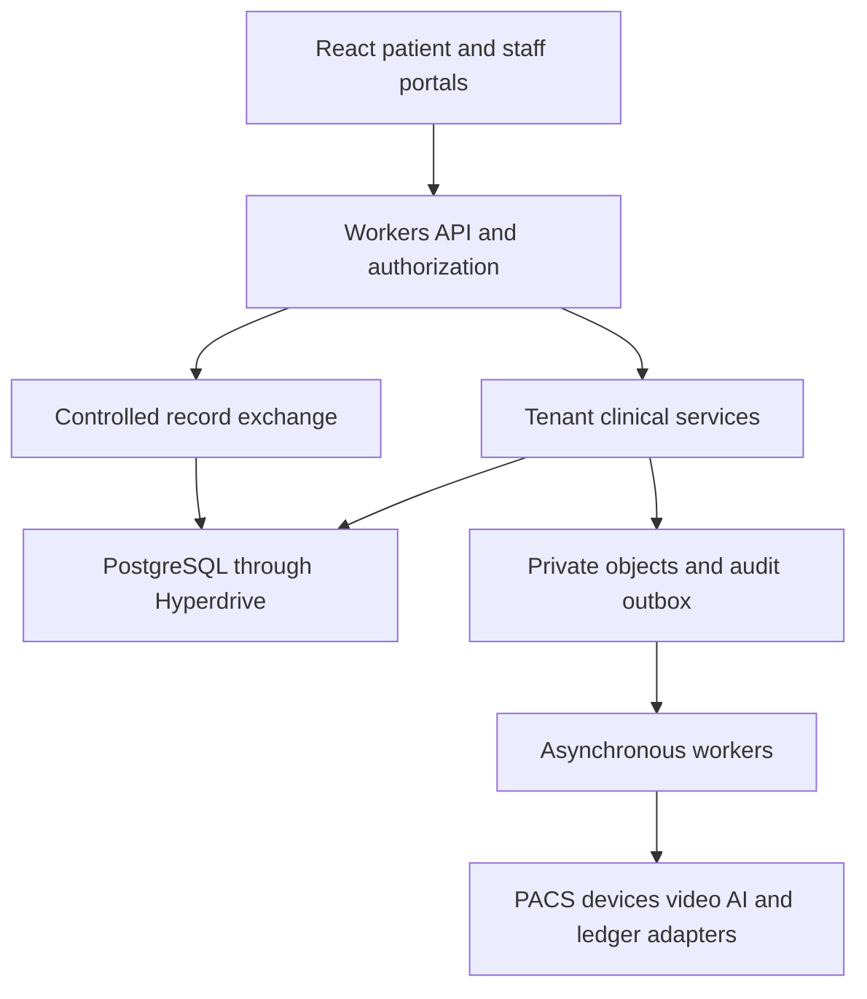

# System architecture

## Proposed topology

React and TypeScript serve the UI. Cloudflare Workers host API orchestration and lightweight background handlers. PostgreSQL provides transactional records, relational integrity and RLS. Hyperdrive supplies database connectivity; disable its query cache for authorization-dependent and clinical queries. Private object storage holds protected documents under an authenticated delivery path; a PACS manages DICOM studies and imaging lifecycle. Use queues for scan jobs, notifications, exports and audit anchors with transactional outbox delivery. Durable Objects may coordinate bounded real-time sessions where justified; they are not the clinical system of record.

Heavy image processing, model inference, long-running analysis, MQTT/device gateways, video media servers and hospital-local modality interfaces run in dedicated services. Workers receive signed, scoped adapter requests and results. Do not assume Workers can host all infrastructure or that every selected Cloudflare service has the same regional processing guarantees.

## Boundaries

Separate platform identity, tenant operations and authorized record exchange. The global patient directory contains minimal identity and controlled record pointers. Clinical entries retain source tenant ownership. Tenant administrative records, prices, staff notes and business reports never become part of the shared chart automatically. Internal global UUIDs do not confer access.

The tenant API uses a runtime role with no superuser, ownership or BYPASSRLS privileges. RLS policies validate tenant ownership and prevent cross-tenant inserts. Use composite keys/FKs where a child must share its parent's tenant. Bind trusted context transaction-locally and clear it by transaction completion; missing context denies. Verify behavior using the actual pooling driver. Do not treat arbitrary client-set PostgreSQL configuration values as trusted access credentials.

The exchange service uses a separate role allowed only narrow read projections and grant checks, not an unrestricted application-admin connection. A reviewed database function or service-mediated query returns approved categories and source attribution only after grant validation. Pin function search paths, parameterize input and minimize privileges. Enforce revocation against the primary database. Do not circumvent tenant isolation by turning off RLS in ordinary requests.

## Transactions and failure

Clinical commands execute validation, current-policy checks, expected-version checks, domain writes, audit events and outbox insertion in one transaction. Outbox dispatcher retries with stable event IDs. Consumers deduplicate transactionally; assume at-least-once delivery. The clinical commit does not wait for email, blockchain confirmation or AI.

For protected reads, select authorized content and persist access evidence before returning bytes. If policy validation or audit persistence fails, return a recoverable service error without chart data. Maintain hospital downtime procedures rather than silently bypassing controls. Recheck grants on downloads; do not distribute durable bearer links as the normal cross-facility mechanism.

## Configuration and module layout

Recommended modules: identity; organizations; credentials; patients; access-policy; encounters; clinical-records; orders; inpatient; theatre; pharmacy; diagnostics; billing; public-health; telehealth; devices; AI; audit. Start as a modular application with clear interfaces; split services only at actual trust, runtime or scaling boundaries.

Environment configuration declares database and storage regions, issuer/audience, secrets references, allowed origins, provider adapters, audit signing key ID, retention policy version and feature flags. Validate at startup. Keep development, staging and production databases, buckets, keys, origins and integration accounts separate. A development mail sink and synthetic adapter are development-only.

## Architecture decisions

ADR01: prefer PostgreSQL for the proposed new clinical backend; retain a working existing backend unless a reviewed migration warrants replacement. ADR02: use FHIR R4 mappings at exchange boundaries, not arbitrary JSON advertised as full FHIR. ADR03: retain private clinical storage and externally verifiable audit proofs rather than on-chain patient records. ADR04: disable clinical query caching. ADR05: separate real-time cloud assistance from certified bedside monitoring. Revisit these with actual provider contracts, load tests and regional constraints.

## Required standards service boundaries

Add a FHIR facade or maintained engine integration, a terminology adapter to a suitable dedicated production terminology service, and a PACS/DICOMweb adapter. Workers authorize and orchestrate these services; PostgreSQL remains the source-owned transactional model unless a reviewed alternative is selected. FHIR projections are derived from versioned domain state. SNOMED CT and LOINC content indexes run in suitable external infrastructure; PACS manages original DICOM objects. Document 19 supersedes candidate-only terminology selection with required staged support. Record ADR06 for FHIR profile/version strategy, ADR07 for terminology service and rights, and ADR08 for PACS conformance and modality gateway design.
