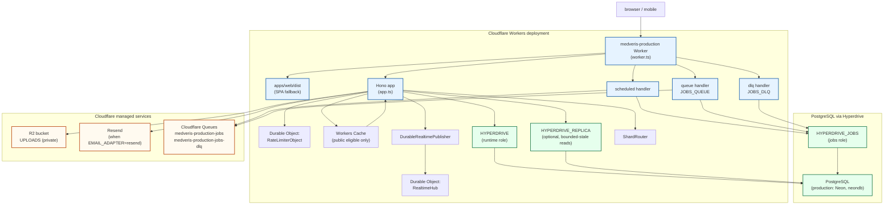
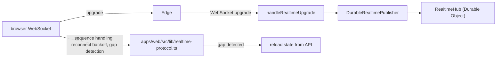

# Medveris deployment architecture (from the current codebase)

## Deployment diagram (Mermaid)

### Realtime path (when enabled per environment)

### Entry points by runtime

- **Node local dev**
  - `apps/api/src/server.ts` via `@hono/node-server`, port `8787`
  - Web: Vite on `5173`, proxying `/api`, `/fhir`, `/terminology` to Node
- **Cloudflare Worker**
  - `apps/api/src/worker.ts`
  - Exports: `fetch`, `scheduled`, `queue`, plus DO classes `RateLimiterObject`, `RealtimeHub`

### Entry points by runtime

- **Node local dev**
  - `apps/api/src/server.ts` via `@hono/node-server`, port `8787`
  - Web: Vite on `5173`, proxying `/api`, `/fhir`, `/terminology` to Node
- **Cloudflare Worker**
  - `apps/api/src/worker.ts`
  - Exports: `fetch`, `scheduled`, `queue`, plus DO classes `RateLimiterObject`, `RealtimeHub`

### Traffic routing shape

- Built web shell is served by Workers static assets with SPA fallback.
- API/FHIR/terminology requests run the Worker first.
- Public-eligible responses can be served from Workers Cache.
- Clinical and permission-dependent results are not served from a shared cache.

---

## Local / staging / production comparison

| Concern | Local | Staging | Production |
|---|---|---|---|
| Runtime host | Node process (`server.ts`) | Cloudflare Worker (`medveris-staging`) | Cloudflare Worker (`medveris-production`) |
| Web serving | Vite dev server | Worker serves `apps/web/dist` | Worker serves `apps/web/dist` |
| API origin | Node on port 8787 | workers.dev origin | `medveris.online` (custom domain) + workers.dev kept for verification |
| Database access | `DATABASE_URL` direct | Hyperdrive: `HYPERDRIVE`, `HYPERDRIVE_JOBS` | Hyperdrive: `HYPERDRIVE`, `HYPERDRIVE_JOBS` (Neon prod) |
| Database roles | one connection string | `medveris_runtime` / `medveris_jobs` | `medveris_runtime` / `medveris_jobs` |
| Query caching | n/a / app-level | disabled on Hyperdrive | disabled on Hyperdrive |
| Read replica | not used | optional via `HYPERDRIVE_REPLICA` | not enabled yet |
| Storage adapter | local filesystem | R2 (`medveris-staging-uploads`) | R2 (`medveris-production-uploads`) |
| Email adapter | local mail sink by default | local or Resend | Resend |
| Terminology mode | synthetic/dev/test | synthetic | unavailable (production provider not contracted) |
| Realtime | dev/test only where configured | enabled in staging vars | disabled until staging failover/WebSocket sign-off |
| Rate-limit coordination | local limiter | Durable Object available | Durable Object available |
| Background jobs | standalone Node runner (`apps/jobs`) or worker local mode | Worker `scheduled` + `queue` on Cloudflare Queues | Worker `scheduled` + `queue` on Cloudflare Queues |
| Cron trigger | n/a | `*/5 * * * *` | `*/5 * * * *` |
| Feature flags | flexible for dev | feature-rich staging config | most advanced integrations off until verified |
| Release model | direct local run | blue-green via `wrangler versions` | blue-green via `wrangler versions` |
| Rollback | manual local repro | `npm run deploy:staging:rollback` | `npm run deploy:production:rollback` |
| Deploy gating | lint/typecheck/test/build | config + remote checks + gate + build + dry-run | stronger config + isolation + migration + backup + domain + secret hygiene + dry-run |
| Custom domain attach | n/a | not used | domain attach is separate step (`npm run domain:production`), not part of deploy |

### What “same Worker, different env” means here

- One Worker source serves API, static assets, scheduled jobs, queue consumption, and Durable Objects.
- Environment differences come from:
  - `wrangler.jsonc` top-level + `env.staging` / `env.production`
  - secrets vs vars split (secrets are Worker secrets, not plaintext vars)
  - bindings (Hyperdrive IDs, R2 bucket, DO classes, queue names)
  - config package (`apps/api/src/config.ts`) deriving runtime behavior from env

### Current production constraints visible in the repo

- `DB_REPLICA_ENABLED` is blocked in production until a read replica is provisioned and failover tested.
- `REALTIME_ENABLED` is blocked in production until staging failover and WebSocket verification is signed off.
- Several integration flags are off in production until adapters are implemented and verified.
- Production expects distinct staging/production PostgreSQL backends; sharing is gated against.
- Migrations are not run by the deploy scripts; they are applied through a separate reviewed procedure.

---

## Deployment checklist (from the deploy scripts + config rules)

### Before any deploy

- [ ] Wrangler is authenticated to the MedVeris account (`6337ed24a5f8ff4ec3f74517a55a7e6b`).
- [ ] Working tree is clean for production releases (uncommitted changes block production deploy).
- [ ] `wrangler.jsonc` has no `REPLACE_WITH` placeholders and no local/staging/production cross-references where the env forbids them.
- [ ] `nodejs_compat` compatibility flag is present.
- [ ] `env.<env>.name` matches the expected Worker name for the target environment.
- [ ] `env.<env>.preview_urls` is `false`.
- [ ] Assets directory binding is present for the built web shell.
- [ ] Cron trigger is declared for the environment.

### Database / Hyperdrive

- [ ] `HYPERDRIVE` and `HYPERDRIVE_JOBS` bindings exist and use different configs.
- [ ] Both bindings resolve to the same target host/port/database for the environment.
- [ ] Query caching is disabled on the Hyperdrive configs.
- [ ] Origin database name matches the expected environment database.
- [ ] Origin user matches the expected role (`medveris_runtime` / `medveris_jobs`).
- [ ] TLS verification is `verify-ca` or `verify-full`.
- [ ] No local/private host is used for remote environments.
- [ ] Staging and production target different PostgreSQL backends.
- [ ] Migration state matches the migration set in `packages/db/migrations`.
- [ ] For production: recent backup/restore drill is recorded and PITR + encrypted backups are enabled.

### Object storage (R2)

- [ ] `UPLOADS` bucket exists for the environment.
- [ ] Public r2.dev access is disabled.
- [ ] No custom domains are attached to the bucket.
- [ ] Only the expected bucket is bound.

### Queues

- [ ] `JOBS_QUEUE` and `JOBS_DLQ` queues exist before deploy.
- [ ] Queue names are prefixed with the environment identity.
- [ ] Consumer has bounded `max_retries` and `max_concurrency`.
- [ ] Main consumer dead-letters to the DLQ.
- [ ] DLQ is consumed to record dead letters.

### Durable Objects

- [ ] `RATE_LIMITER` and `REALTIME` bindings map to the right DO class names.
- [ ] Bindings use this Worker's own class, not another script.
- [ ] Migration creates the DO classes as SQLite-backed (`new_sqlite_classes`).
- [ ] If a new DO migration is pending and doing a gradual release, use `wrangler deploy` path instead of `wrangler versions upload`.

### Secrets and config hygiene

- [ ] Required secrets are declared in `env.<env>.secrets.required`.
- [ ] Required secrets are not duplicated as plaintext vars.
- [ ] Secret-like vars (`SECRET`, `PASSWORD`, `TOKEN`, `_KEY`, `CONNECTION_STRING`, `DATABASE_URL`) are not stored as plaintext vars.
- [ ] Staging/production secrets are stored outside the repo and mode `0600`.
- [ ] Deploy scripts upload only missing secrets, never overwriting existing ones.
- [ ] Core secrets are distinct values in staging.
- [ ] Resend key is valid when email adapter is Resend.
- [ ] Email sender domain matches the verified sending domain for the environment.
- [ ] `AUDIT_SIGNING_KEY_ID` follows the expected production key id pattern.

### Environment-specific config rules

#### Staging
- [ ] `APP_ENV=staging`
- [ ] Origin is the staging workers.dev origin
- [ ] `EXPECTED_DATABASE_NAME` matches staging DB
- [ ] `STORAGE_ADAPTER=r2` and `TERMINOLOGY_MODE=synthetic`
- [ ] `DEV_SHOW_TOTP_SECRETS=false`
- [ ] `FHIR_EXTERNAL_WRITES_ENABLED=false`, `FHIR_BULK_EXPORT_ENABLED=false`
- [ ] Staging config references no production resources/values
- [ ] Staging config references no local-only placeholders in remote checks

#### Production
- [ ] `APP_ENV=production`
- [ ] Origin is `https://medveris.online`
- [ ] `EXPECTED_DATABASE_NAME=neondb`
- [ ] `STORAGE_ADAPTER=r2`, `EMAIL_ADAPTER=resend`
- [ ] `DEV_SHOW_TOTP_SECRETS=false`
- [ ] `FHIR_EXTERNAL_WRITES_ENABLED=false`, `FHIR_BULK_EXPORT_ENABLED=false`
- [ ] `TERMINOLOGY_MODE=unavailable` or `production` with HTTPS provider URL
- [ ] Integration feature flags are `false` until verified
- [ ] `FEATURE_PAYMENTS` is true/false only; if true, `YO_MODE=production` and Yo secrets are declared
- [ ] `FEATURE_DICOMWEB` is true/false only; if true, base URL is HTTPS and credentials are via secrets
- [ ] `DB_REPLICA_ENABLED` stays false until replica failover is verified
- [ ] `REALTIME_ENABLED` stays false until staging WebSocket/failover sign-off
- [ ] Production routes are only custom domains for `medveris.online` / `www.medveris.online`
- [ ] Observability enabled with query-string redaction
- [ ] `version_metadata` binds `CF_VERSION_METADATA`

### Build and release

- [ ] Web build succeeds and produces `apps/web/dist/index.html` plus the expected entry bundle.
- [ ] API build produces `apps/api/dist/server.mjs` and `apps/api/dist/worker.mjs`.
- [ ] Lint, typecheck, and tests pass.
- [ ] For production: dependency audit at high/critical level passes.
- [ ] `wrangler deploy --dry-run` succeeds with no placeholders, no local-only refs, and no wrong-environment refs.
- [ ] If PO migration is pending, release with `wrangler deploy`, not blue-green.
- [ ] Blue-green: upload green, stage at 0%, verify with version override, promote to 100%, verify on live traffic.
- [ ] On promotion failure or post-promotion verification failure, restore blue.
- [ ] After deploy, deploy cron triggers for the environment.

### Domain (production only)

- [ ] Domain attach is done by `npm run domain:production`, not by the deploy script.
- [ ] Attached domains match declared domains in `wrangler.jsonc`.
- [ ] `workers_dev` is not disabled until `medveris.online` is attached and declared.

### Post-deploy verification

- [ ] Health/readiness checks respond.
- [ ] Public config endpoint reports the expected env and terminology posture.
- [ ] Protected routes return proper unauthenticated responses.
- [ ] Missing routes return structured JSON 404.
- [ ] Version metadata header reflects the deployed version.
- [ ] Release evidence is written for production runs.

---

## Notes / open items from the current code

- Production is not yet using read replicas or realtime, even though the architecture supports them.
- Several features are present in the app surface but gated off in production config until adapters are implemented/verified.
- The repo contains both a standalone Node jobs runner (`apps/jobs`) and the Worker queue/scheduler path; the deployed production path is the Worker path.
- Database migrations are intentionally not part of the deploy scripts.
